<p align="center">
  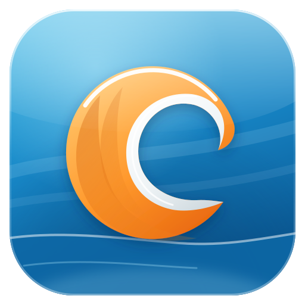
</p>

# WaveMP

**A nostalgic media player for your self-hosted music and music videos.**

[](https://github.com/wavemp-app/wavemp/actions/workflows/main.yml)
[](https://github.com/wavemp-app/wavemp/releases)
[](LICENSE)
[](https://hub.docker.com/r/wavemp/wavemp)
[](https://hub.docker.com/r/wavemp/wavemp)

> **Status:** WaveMP is in active development and already a complete player for your music and music videos. Everything listed under Features works today, except where it is marked as planned; the [releases](https://github.com/wavemp-app/wavemp/releases) describe what each milestone added. Profiles can be protected with a PIN, but WaveMP has no accounts with passwords, so do not expose it to the internet without protection.

## About

WaveMP brings back the glossy, glassy look of the classic desktop media players from the Frutiger Aero era, and combines it with what you expect from a modern music app. Point it at your media folder, and it builds a library you can play from any browser on your network.

## Features

- **Your library, your files.** WaveMP scans one or more folders and organizes your music. It reads tags first and falls back to your folder structure.
- **Tag editor.** Admins correct title, artist, album, album artist, year, track and disc number and genre right in WaveMP. Changes are written into the audio file, never into videos, and the previous tags are kept in the database. New songs wait in a review inbox until an admin has checked their tags.
- **Music and music videos together.** Switch seamlessly between the audio track, its music video, its cover and a visualization.
- **Fast library.** Covers are scaled to the size they are shown in and cached, so lists and tiles load quickly.
- **Profiles.** Pick your profile, no login required. Each profile has its own playlists and history, shows an own picture or one of the built-in ones, and can be protected with an optional PIN.
- **Gapless player.** Songs follow each other without a gap, with a queue you can edit, shuffle, repeat, volume leveling (ReplayGain) and the media keys and lock screen controls of your device.
- **Equalizer, crossfade and sleep timer.** A ten-band equalizer with presets and your own curve, crossfades of up to twelve seconds that leave the songs of an album gapless, and a sleep timer that fades the music out after a time or at the end of the song or the queue.
- **Favorites and ratings.** Mark songs, albums and artists with a heart, rate songs with up to five stars and narrow the whole library down to your own music. The home page greets you with your playlists, the songs you played recently, new albums, your favorites and your top rated songs.
- **Playlists.** Each profile builds its own playlists, sorted by drag and drop, with an own cover or the covers of their songs fading into each other, plus an automatic list of the songs played recently.
- **Visualizations.** Classic Milkdrop presets plus WaveMP's own styles, *A-Force* and *BlackCap*.
- **Lyrics.** Synchronized lyrics follow the music line by line or word by word, from `.lrc` files, from the tags of your files or, if you switch it on, downloaded from LRCLIB.
- **Plays almost anything.** Formats your browser supports are streamed directly; everything else is transcoded on the fly with ffmpeg. Intel Quick Sync is supported for hardware acceleration.
- **Casting.** Send the music, or the music video, to a Chromecast from Chrome and Edge or to an AirPlay device from Safari, while the queue and the controls stay in WaveMP.
- **Scrobbling.** Each profile can send what it listens to to Last.fm or ListenBrainz. Scrobbles wait in the database while a service is down and are sent later.
- **Subsonic apps.** Play your library on the phone with apps for the Subsonic API, such as Symfonium, play:Sub or Substreamer, with your favorites, ratings, playlists and plays. Each profile switches the access on and signs in with its own app password.
- **Easy setup.** One compose file, one password, your media folder. That's it.
- **Daily backups.** The database is exported every day and before every update, and the last exports are kept next to your other data.
- **Open API.** A documented REST API (OpenAPI) for building your own clients. Native apps are planned.
- **Installable as an app (PWA)** on desktop and mobile devices.
- **Your language.** English and German are built in, more languages come from the community through [Weblate](https://hosted.weblate.org/engage/wavemp/). A language appears in WaveMP as soon as its translation exists; texts that are not translated yet are shown in English. See [Translations](#translations).
- **Themes.** The look is a theme: one CSS file plus graphics, from colors to the complete desktop layout. WaveMP ships with six themes: *Midnight* (the default), *Meadow*, *Daylight*, *Accent*, *Pinstripe* and *Clear Glass*. Every profile picks its theme in the settings, from tiles with a preview, and the app switches at once. *Accent* and *Clear Glass* come in a light and a dark variant; "Light or dark" in the settings follows the device or keeps one of them. *Clear Glass* takes on the color of the cover that is playing. Admins can add own themes as ZIP packages under **Administration > Themes**; see [THEMING.md](THEMING.md) for writing one.

## Screenshots

| | |
|---|---|
| 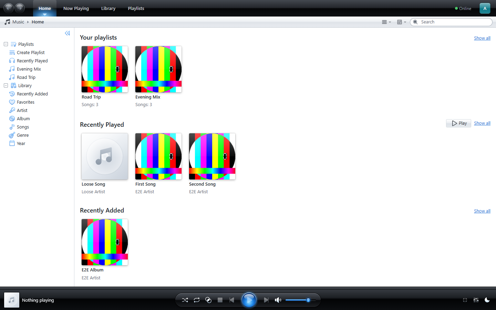 | 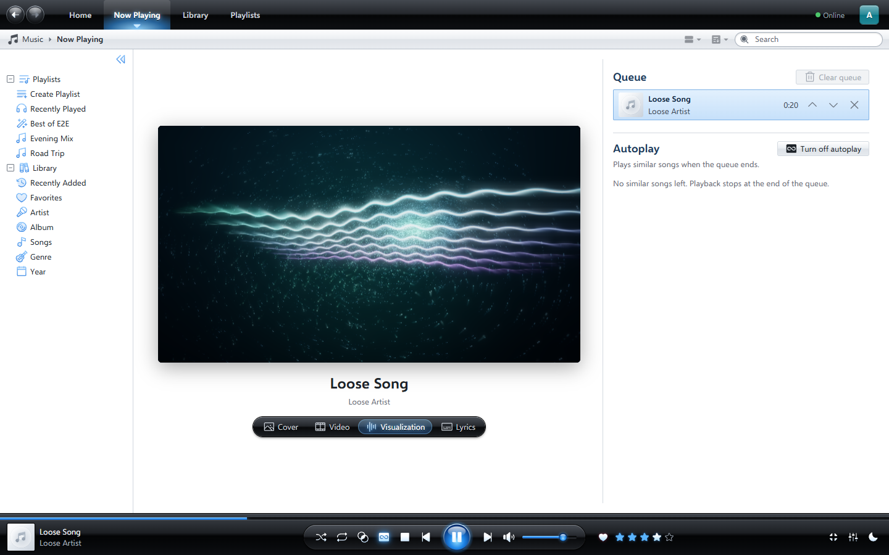 |
| **Home** with your playlists, the songs you played recently and new albums | **A-Force**, one of WaveMP's own visualizations |
| 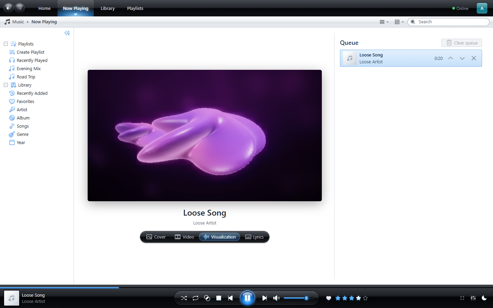 | 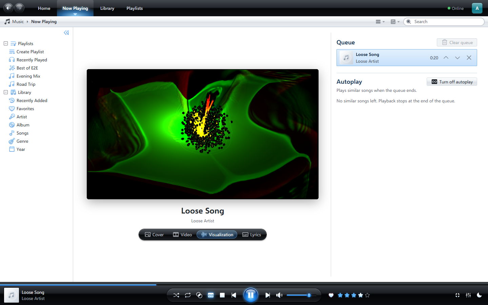 |
| **BlackCap**, the calm 3D visualization | Classic **Milkdrop** presets |
| 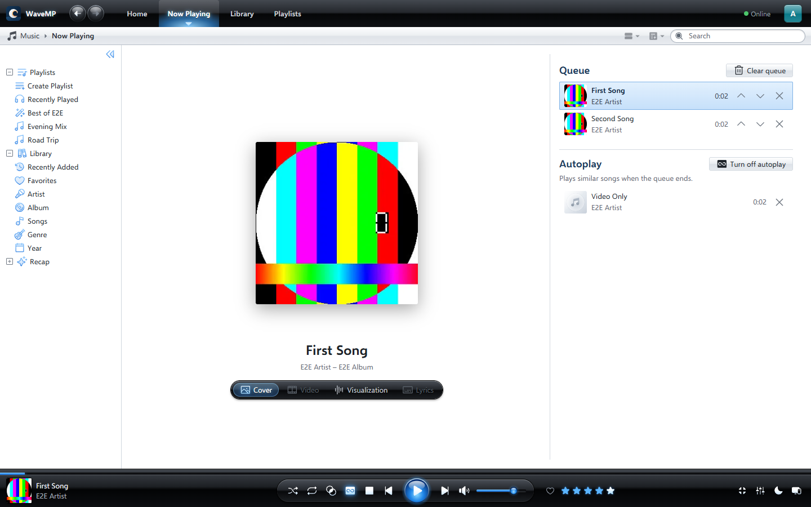 | 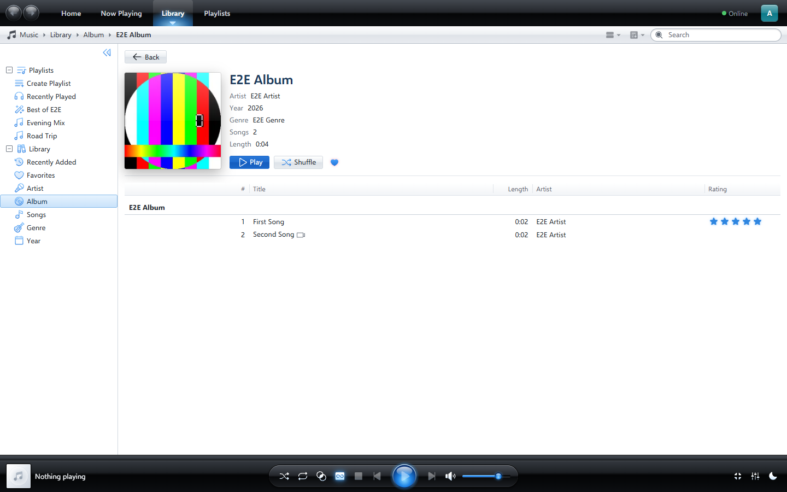 |
| **Now Playing** with cover and queue | An **album** with its songs |
| 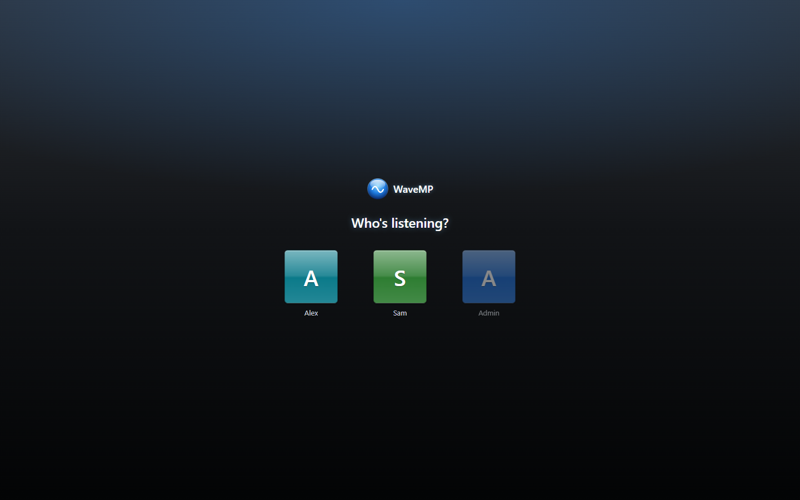 | 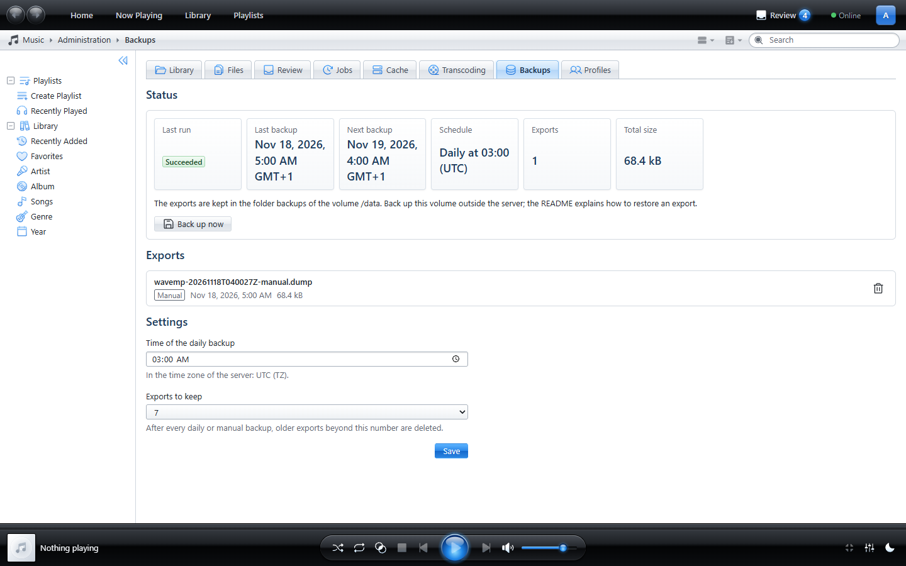 |
| **Profiles** instead of a login | **Administration** of the daily backups |

<p>
  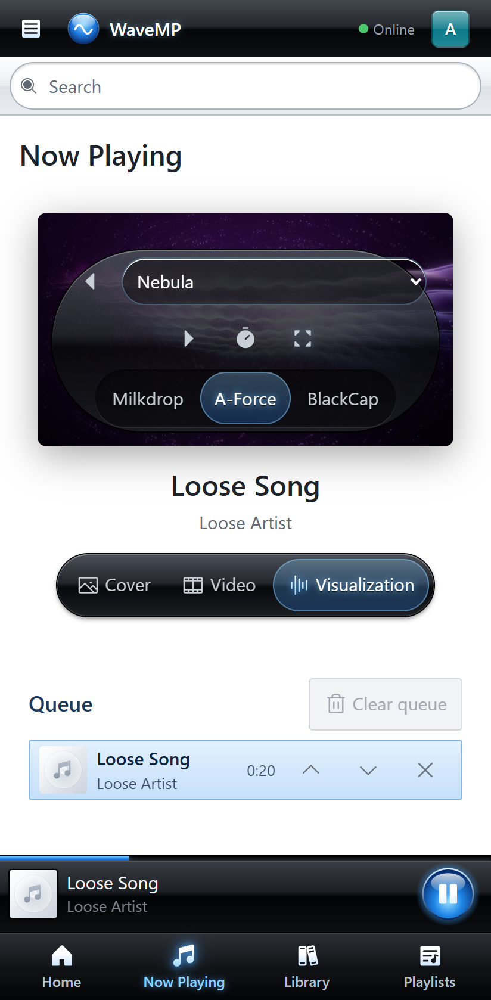
  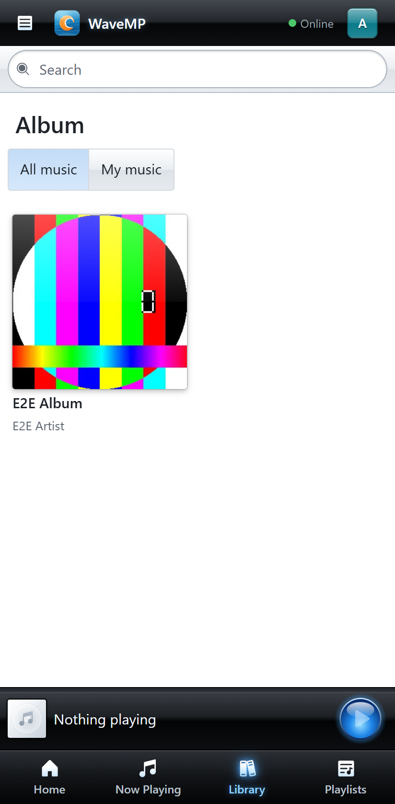
</p>

The screenshots show the synthetic test media of the end-to-end tests (sine tones and test pictures) in the theme *Midnight*.

## Quick Start

WaveMP runs as two containers: the app, published on Docker Hub as [`wavemp/wavemp`](https://hub.docker.com/r/wavemp/wavemp), and a PostgreSQL database.

Create a `.env` file with a database password of your choice:

```env
DB_PASSWORD=change-me-to-a-long-random-password
```

Create a `docker-compose.yml` next to it:

```yaml
services:
  wavemp:
    image: wavemp/wavemp:latest
    container_name: wavemp
    ports:
      - "8080:8080"
    environment:
      DB_HOST: wavemp-db
      DB_PASSWORD: ${DB_PASSWORD:?Please set DB_PASSWORD in .env}
    volumes:
      # Data of WaveMP that is not in the database: the daily exports of the database (backups),
      # the covers of playlists and the cache of scaled covers.
      - wavemp-data:/data
      # Append :ro to keep WaveMP from changing your files; the metadata editor is then off.
      - /path/to/your/media:/media
      # Further media folders, for example on another disk: mount each one at its own path and
      # add it under Administration > Library > Media folders (see "Several media folders").
      # - /path/to/your/videos:/media-videos:ro
    depends_on:
      wavemp-db:
        condition: service_healthy
    restart: unless-stopped

  wavemp-db:
    image: postgres:18
    container_name: wavemp-db
    environment:
      POSTGRES_USER: wavemp
      POSTGRES_DB: wavemp
      POSTGRES_PASSWORD: ${DB_PASSWORD:?Please set DB_PASSWORD in .env}
    volumes:
      - wavemp-db:/var/lib/postgresql
    healthcheck:
      test: ["CMD-SHELL", "pg_isready -U wavemp -d wavemp"]
      interval: 10s
      timeout: 5s
      retries: 5
    restart: unless-stopped

volumes:
  wavemp-data:
  wavemp-db:
```

The database is not exposed outside the Docker network.

Start it:

```bash
docker compose up -d
```

Open `http://<your-server>:8080` and select the **Admin** profile to set up your library. WaveMP scans your media folders one minute after the start and then every six hours; changes are also picked up within seconds by watching the folders.

WaveMP can be installed as an app (PWA). Browsers require HTTPS for that, except on `localhost`, for example behind a reverse proxy with TLS. Casting to Chromecast devices needs HTTPS as well; AirPlay works without it.

### Image tags

Images are built for `linux/amd64` and `linux/arm64` and published on Docker Hub as [`wavemp/wavemp`](https://hub.docker.com/r/wavemp/wavemp/tags), where all tags are listed. Every change on `main` that passes all tests is published as a new version `1.0.N`:

| Tag | Content |
|---|---|
| `latest` | Current version; the Quick Start uses it |
| `1.0.N` | A specific version, for example `1.0.42`; use it to pin your installation and update on your own schedule |
| `1.0` | Current version of the 1.0 series |
| `edge` | Same as `latest` |
| `sha-<commit>` | The version of a specific commit on `main` (short hash) |

The running version is shown under **Settings** and reported by `GET /api/v1/health`. Each completed milestone is also marked as a [GitHub release](https://github.com/wavemp-app/wavemp/releases) with release notes, named after the version it was published with.

> **Alternative registry:** The same images with the same tags are also available from the GitHub Container Registry as [`ghcr.io/wavemp-app/wavemp`](https://github.com/wavemp-app/wavemp/pkgs/container/wavemp), for example `ghcr.io/wavemp-app/wavemp:latest`.

### Settings

| Variable | Description | Default |
|---|---|---|
| `DB_PASSWORD` | Database password, used by both containers | *(required)* |
| `ADMIN_PIN` | PIN of the built-in admin profile, 4 to 8 digits. Set at every start and cannot be changed in the app while the variable is set; see [Profiles and PINs](#profiles-and-pins) | *(none)* |
| `LASTFM_API_KEY` | API key of your Last.fm API account, needed to scrobble to Last.fm; see [Scrobbling](#scrobbling) | *(none)* |
| `LASTFM_SHARED_SECRET` | Shared secret of the same Last.fm API account | *(none)* |
| `MEDIA_PATH` | First media folder inside the container; only change it if you mount your media elsewhere. Further folders are added in the app, see [Several media folders](#several-media-folders) | `/media` |
| `DATA_PATH` | Data folder inside the container (cache, covers of playlists, pictures of the profiles, uploaded themes, keys and the exports of the database); only change it if you mount the volume elsewhere | `/data` |
| `TZ` | Time zone of the server, for example `Europe/Berlin`; the daily backup runs at its time of day in this zone | `UTC` |
| `PUID` | User id that WaveMP runs as; see [User and permissions](#user-and-permissions) | `1654` |
| `PGID` | Group id that WaveMP runs as | `1654` |
| `Streaming__SignedUrlLifetime` | How long a stream address stays valid after it was handed out, on top of the length of the song | `01:00:00` |
| `Streaming__CastSignedUrlLifetime` | The same for stream and cover addresses handed to a casting device, which may load a song again long after it started, for example after a pause | `06:00:00` |
| `Streaming__MaxSignedUrlLifetime` | Upper limit of that validity, also for very long songs | `1.00:00:00` |
| `Streaming__HistoryMaxAge` | How old a play may be when a client reports it to the history, for example after it was offline | `7.00:00:00` |
| `Pins__MaxFailedAttempts` | Wrong PINs in a row after which a profile is locked | `5` |
| `Pins__LockoutDuration` | How long a profile stays locked after too many wrong PINs | `00:05:00` |
| `Avatars__MaxUploadBytes` | Largest picture in bytes that can be uploaded as the picture of a profile | `10485760` (10 MB) |
| `Themes__MaxUploadBytes` | Largest theme package (ZIP file) in bytes that admins can upload; `Themes__MaxUnpackedBytes`, `Themes__MaxFileBytes`, `Themes__MaxStylesheetBytes`, `Themes__MaxFontBytes` and `Themes__MaxEntries` limit its content, see [THEMING.md](THEMING.md#uploaded-themes) | `10485760` (10 MB) |
| `Lyrics__RequestInterval` | Shortest time between two requests to LRCLIB while lyrics are downloaded | `00:00:01` |
| `Lyrics__LrclibUrl` | Address of LRCLIB, for example of a mirror you host yourself | `https://lrclib.net/` |
| `Lyrics__LookUpAgainAfter` | How long WaveMP waits before it looks up the lyrics of a song again that LRCLIB had no lyrics for (or listed as instrumental); `00:00:00` never looks such a song up again | `30.00:00:00` |
| `Scrobbling__MaxAge` | How long a scrobble waits in the queue while a service cannot be reached before it is dropped | `14.00:00:00` |
| `Scrobbling__MaxRetryDelay` | Longest pause between two attempts to reach a scrobbling service | `01:00:00` |
| `Transcoding__RenderDevice` | Render device for hardware transcoding, for example `/dev/dri/renderD129` on a server with more than one GPU; by default the first device under `/dev/dri` | *(first device)* |

Audio, video and other media are streamed through short-lived signed addresses, bound to the song and the profile, because players and casting devices cannot send a login token. The signing key is created on the first start and kept in the database. Casting devices load these addresses themselves, so the server answers them with CORS headers for any origin; the signature remains the only access check.

### User and permissions

The container starts as root, prepares the data folder and then runs WaveMP as the user `PUID` and the group `PGID`, `1654` (the user `app` of the image) by default. Files WaveMP writes, such as edited tags, the exports of the database and the cache, belong to this user. Set both to a user of your server that may read your media, for example `99` and `100` on Unraid or the ids that `id <user>` prints:

```yaml
services:
  wavemp:
    # ...
    environment:
      # ...
      PUID: "1000"
      PGID: "1000"
```

- Before WaveMP starts, the data folder (`/data`) is handed to this user and group, so a folder that your server created as root works without further steps. Only the folder itself changes owner; folders and files inside it stay as they are. If you switch an existing installation to another user, hand the whole folder to it once, for example `sudo chown -R 1000:1000 /path/to/wavemp/data`.
- Groups added with `group_add` are kept, and the groups of the render devices under `/dev/dri` are added, so [hardware transcoding](#hardware-transcoding-optional) works without `group_add`.
- `PUID=0` runs WaveMP as root.
- If you start the container as another user with `user:` (`--user`), as TrueNAS does, WaveMP runs as that user, `PUID` and `PGID` are ignored and the data folder is not changed; it must already be writable for this user.

### Hardware transcoding (optional)

Songs and videos your browser cannot play are transcoded on the fly by ffmpeg into an HLS stream (H.264 video, AAC sound). Software transcoding always works. On a server with an Intel CPU or GPU with Quick Sync, WaveMP encodes videos on the graphics hardware instead, which needs much less processor power; the image brings the Intel drivers (VA-API and oneVPL, `linux/amd64` only).

Pass the render device into the container:

```yaml
services:
  wavemp:
    # ...
    devices:
      - /dev/dri:/dev/dri
```

WaveMP adds the group of the device (usually the group `render`, sometimes `video`) to its user when the container starts, so the user `PUID` can open it. If you start the container as another user with `user:`, add the group yourself with `group_add` and the numeric group id of the device, which `stat -c '%g' /dev/dri/renderD128` prints on the host:

```yaml
    group_add:
      - "993"
```

On every start, and when the setting changes, WaveMP looks for a render device under `/dev/dri` and tests Quick Sync (QSV) and then VA-API with a short test encode. **Administration > Transcoding** shows the result: the encoder and the device in use, or why the hardware is not used (no render device, test failed). If a transcode on the hardware fails, WaveMP repeats it in software. Set **Hardware acceleration** there to **Off (software only)** to always transcode in software, and choose the device with `Transcoding__RenderDevice` if the server has more than one GPU.

### Several media folders

WaveMP can scan and watch several folders, for example your music on one disk and your music videos on another. Each folder is mounted as its own volume and then added as a media folder:

```yaml
    volumes:
      - wavemp-data:/data
      - /mnt/music:/media
      - /mnt/videos:/media-videos:ro
```

Then open **Administration > Library**. Under **Media folders**, an admin adds a folder with a name and its path inside the container (here `/media-videos`), renames it, moves it to another path, switches it off or removes it.

- The first media folder is the one of `MEDIA_PATH` (`/media` by default). Existing installations keep their library: after the update, their library belongs to this folder. While its path is not changed in the app, it follows `MEDIA_PATH`.
- The path must be the full path of a folder that exists in the container and must neither lie inside another media folder nor contain one.
- A new or moved folder is scanned at once. Each folder is scanned and watched on its own; a folder that is missing or cannot be read is skipped and shown as a problem of the scan, and the songs of the other folders stay as they are.
- Switching a folder off keeps its songs in the library, but they are no longer updated. Removing a folder removes its songs with their ratings, favorites and playlist entries from the library; the files themselves stay untouched.
- Files of one song still belong together by their base name in the same folder (see [Organizing Your Media](#organizing-your-media)), so the files of a song cannot be spread over two media folders.
- As soon as there is more than one media folder, the songs, recently added songs, albums and artists of the library can be filtered by media folder.

### Media folder access

- Mount the folder **read-only** (`/path/to/your/media:/media:ro`) if WaveMP should never change your files. The metadata editor then shows its fields greyed out with a hint.
- Mount it **writable** if you want to edit tags from within WaveMP. Changes are only written to audio files, never to videos, and file names stay as they are.
- WaveMP runs as user `1654` by default, or as the user `PUID` and the group `PGID` (see [User and permissions](#user-and-permissions)); your files and folders must be readable for it. To edit tags, the audio files must also be writable for it, for example by running WaveMP as the owner of your media with `PUID` and `PGID`, or through a group with write permission that you add to the container with `group_add` in the compose file. No rescan is needed after changing the mount or the permissions: the editor checks the file each time it opens.

### Data folder and cache

WaveMP keeps everything that is not in the database in the volume mounted at `/data`. Its folder `cache` holds the covers scaled to 96, 300 and 1000 pixels as WebP, so lists and tiles load quickly. They are created the first time a cover is shown; after every scan WaveMP also prepares the two smaller sizes of every cover and removes those of changed or deleted pictures (job **Prepare covers** under **Administration > Jobs**). The cache is limited to 2 GB by default: when it grows larger, the files used least recently are removed. Change the limit or clear the cache under **Administration > Cache**.

The folder `playlists` holds the pictures uploaded as covers of playlists, and the folder `avatars` the pictures uploaded for profiles, both as square WebP files in the three sizes; the uploaded originals are not kept. The folder `themes` holds the themes uploaded by admins, one folder per theme. Unlike the cache, they belong in your backup.

The folder `keys` holds the keys WaveMP protects data with that must survive a restart. Only the user that runs WaveMP may open it, because the keys are stored unencrypted; WaveMP creates it on the first start and needs no home folder of its user for it. Keep it in your backup together with the rest of `/data`.

The cache also holds transcoded media in its folder `transcodes`: the segments of the HLS streams of songs and videos your browser cannot play. A part that was transcoded once comes from the cache the next time; like the covers, the segments count towards the size limit and are removed when they were used least recently.

Everything in the cache is created again when it is needed, so it does not have to be backed up. If `/data` cannot be written, WaveMP still works, shows the covers unscaled and skips songs and videos that would need transcoding; the cache page, the transcoding page and the log tell you so.

### Backup & Restore

WaveMP exports its database every day at 03:00 into the folder `backups` of the data volume (`/data/backups`), as a compressed PostgreSQL dump named after the time (UTC) and what created it, for example `wavemp-20261116T030000Z-schedule.dump`. The last 7 exports are kept; older ones are deleted after every export. Before an update changes the structure of the database, WaveMP exports it first (`...-migration.dump`); if that export fails, WaveMP does not touch the database and stops with an error in the log. **Administration > Backups** shows the last and next backup and the exports, backs up on demand, deletes exports and sets the time of day and the number of exports to keep. The time of day is the local time of the server; set the time zone with `TZ`, for example `TZ: Europe/Berlin` under `environment` of `wavemp`. The page names this time zone next to the time of day, and shows the last and next backup in the time zone of the browser together with its name.

The exports stay on the same disk as the database, so copy them elsewhere with the backup tool of your choice. Back up:

- the volume `wavemp-data` (mounted at `/data`): the exports of the database in `backups`, the covers of playlists in `playlists`, the pictures of the profiles in `avatars`, the uploaded themes in `themes` and the keys in `keys`; its folder `cache` can be left out,
- your media folder, which WaveMP does not back up.

The database volume `wavemp-db` itself does not need to be copied: the exports contain everything in it, while a copy of the files of a running database may be inconsistent.

To restore an export, stop WaveMP, replace the database with the export and start WaveMP again. In the folder of your `docker-compose.yml`, with the file name of the export:

```bash
docker compose stop wavemp
docker compose cp wavemp:/data/backups/wavemp-20261116T030000Z-schedule.dump ./restore.dump
docker compose exec wavemp-db dropdb --username=wavemp --force wavemp
docker compose exec wavemp-db createdb --username=wavemp wavemp
docker compose exec -T wavemp-db pg_restore --username=wavemp --dbname=wavemp --no-owner < ./restore.dump
docker compose start wavemp
```

An export of an older version of WaveMP is updated to the current version on the next start. To restore on a new server, start WaveMP once with an empty database, copy the data volume back (or the export into the new volume) and restore the export as above. Restoring is not possible in the web app, so a wrong click cannot replace your library.

## Installation

The [Quick Start](#quick-start) works on every system with Docker and docker compose. This section explains the particularities of common NAS systems. On every platform WaveMP needs:

- a PostgreSQL 18 database next to it, with the same database password in both containers,
- your media folder at `/media`, readable for WaveMP, and writable if you want to edit tags,
- a persistent folder at `/data` for the daily exports of the database (`backups`), uploaded pictures and the cache,
- optionally the render device `/dev/dri` of an Intel CPU or GPU for [hardware transcoding](#hardware-transcoding-optional).

The templates for the app catalogs of TrueNAS, Unraid, ZimaOS and CasaOS are in [`deploy/`](deploy/README.md). They use the fixed version of the latest milestone release (`1.0.N`) and are raised with every milestone release. WaveMP is not listed in these catalogs yet; until then, each section names a way to install it without the catalog.

### TrueNAS

For TrueNAS Community Edition 24.10 or later. Install **WaveMP** under **Apps > Discover Apps** and fill in the form:

- **Database Password** (required): a long random password; the app sets it for WaveMP and its PostgreSQL database alike. **Admin PIN** is optional.
- **Media Storage**: choose **Host Path** and the dataset with your music and music videos. WaveMP runs as the user `apps` (568) by default, so give this user read access to the dataset (**Datasets > Permissions**), and write access if you want to edit tags. With **Read Only** WaveMP never changes your files.
- **WaveMP Data Storage** and **WaveMP Postgres Data Storage**: keep **ixVolume** (datasets created for the app) or choose host paths. The data storage holds the exports of the database in its folder `backups`; include it in your snapshots or replication.
- **Hardware transcoding**: under **Resources Configuration > GPU Configuration**, pass the Intel GPU (**Passthrough available (non-NVIDIA) GPUs**).

Without the catalog: install the compose file of the [Quick Start](#quick-start) with **Apps > Discover Apps > Install via YAML**, with host paths of your datasets instead of the volumes `wavemp-data` and `wavemp-db`, the password in place of `${DB_PASSWORD:?...}`, and `user: "568:568"` under `wavemp`.

### Unraid

WaveMP and its database are two templates in Community Applications, `WaveMP` and `wavemp-db`, which talk to each other in their own Docker network:

1. Create the network once in the terminal of Unraid: `docker network create wavemp`.
2. Install **wavemp-db** and set a **Database password**. Its files are stored in `/mnt/user/appdata/wavemp-db`.
3. Install **WaveMP** with the same **Database password**. **Media** is your share with music and music videos (set the access mode to read only if WaveMP should never change your files), **Data** is `/mnt/user/appdata/wavemp`, which holds the exports of the database in its folder `backups`; include it in your appdata backup.
4. **Hardware transcoding**: in the advanced view of the template, set **Intel GPU** to `/dev/dri`. The device exists when the driver of the Intel GPU is loaded on the server.

Both containers start with `--restart unless-stopped`, so WaveMP waits for the database by starting again. WaveMP runs as the user `nobody` (99) and the group `users` (100) of Unraid, set as **User ID** (`PUID`) and **Group ID** (`PGID`) in the advanced view: it starts as root, hands its appdata folder to this user and then runs as it, so files it writes, such as edited tags, belong to `nobody:users` like the other files of your shares. Earlier versions of the template ran WaveMP as root; for such an installation, hand the appdata folder to the new user once in the terminal: `chown -R 99:100 /mnt/user/appdata/wavemp`.

Without the catalog: save both templates into the templates folder of Unraid and add them under **Docker > Add Container > Template**:

```bash
cd /boot/config/plugins/dockerMan/templates-user
wget -O my-wavemp-db.xml https://raw.githubusercontent.com/wavemp-app/wavemp/main/deploy/unraid/wavemp-db.xml
wget -O my-WaveMP.xml https://raw.githubusercontent.com/wavemp-app/wavemp/main/deploy/unraid/wavemp.xml
```

### ZimaOS and CasaOS

Install **WaveMP** from the **App Store**. Before the first start, open the settings of the app and replace the database password `casaos` with your own: the same value for `DB_PASSWORD` (container `wavemp`) and `POSTGRES_PASSWORD` (container `wavemp-db`).

- **Media**: `/DATA/Media/Music` by default; choose another folder under **Volumes** of the container `wavemp`.
- **Data**: `/DATA/AppData/wavemp/data` holds the exports of the database in its folder `backups`, `/DATA/AppData/wavemp/db` the database itself.
- **Hardware transcoding**: add the device `/dev/dri` to the container `wavemp` in the settings of the app (ZimaBoard, ZimaBlade and ZimaCube have Intel graphics).

WaveMP runs as the user of ZimaOS and CasaOS (`PUID` and `PGID`, which the system fills in, usually `1000`): it starts as root, hands its data folder to this user and then runs as it, so files it writes, such as edited tags, belong to this user. Earlier versions of the app ran WaveMP as root; for such an installation, hand the data folder to the new user once in the terminal: `sudo chown -R 1000:1000 /DATA/AppData/wavemp/data`.

Without the store: **App Store > Custom Install** (the plus icon), **Import**, and paste [`deploy/casaos/WaveMP/docker-compose.yml`](deploy/casaos/WaveMP/docker-compose.yml).

### Synology Container Manager

For DSM 7.2 or later with the package **Container Manager**. WaveMP runs as a DSM user of your choice, so it has the same access to your files as this user:

1. In **File Station**, create the folders `wavemp/data` and `wavemp/db` in the shared folder `docker`.
2. Find the user and group id of a DSM user with access to your music: in an SSH session, `id <user>` prints for example `uid=1026` and `gid=100`.
3. In **Container Manager > Project > Create**, choose the path `/volume1/docker/wavemp` and **Create docker-compose.yml**, and paste:

```yaml
services:
  wavemp:
    image: wavemp/wavemp:latest
    container_name: wavemp
    # User and group id of step 2.
    user: "1026:100"
    ports:
      - "8080:8080"
    environment:
      DB_HOST: wavemp-db
      DB_PASSWORD: change-me-to-a-long-random-password
      TZ: Europe/Berlin
    volumes:
      - /volume1/docker/wavemp/data:/data
      # Your music and music videos; append :ro to keep WaveMP from changing your files.
      - /volume1/music:/media
    depends_on:
      wavemp-db:
        condition: service_healthy
    restart: unless-stopped

  wavemp-db:
    image: postgres:18
    container_name: wavemp-db
    environment:
      POSTGRES_USER: wavemp
      POSTGRES_DB: wavemp
      # The same password as DB_PASSWORD above.
      POSTGRES_PASSWORD: change-me-to-a-long-random-password
    volumes:
      - /volume1/docker/wavemp/db:/var/lib/postgresql
    healthcheck:
      test: ["CMD-SHELL", "pg_isready -U wavemp -d wavemp"]
      interval: 10s
      timeout: 5s
      retries: 5
    restart: unless-stopped
```

Change the paths to your volume and shared folders, and the port on the left (`8080:`) if it is taken. The exports of the database end up in `docker/wavemp/data/backups`, where Hyper Backup can pick them up.

**Hardware transcoding** works on models with an Intel CPU that have `/dev/dri`. Add the device and the group of the render device (`stat -c '%g' /dev/dri/renderD128` in an SSH session) to `wavemp`:

```yaml
    devices:
      - /dev/dri:/dev/dri
    group_add:
      - "937"   # the group id printed by stat
```

### QNAP Container Station

For Container Station 3 or later: **Applications > Create**, give the application the name `wavemp` and paste the compose file of [Synology](#synology-container-manager) with QNAP paths:

- `user`: the user and group id of a QTS user with access to your music (`id <user>` in an SSH session),
- `/share/Container/wavemp/data:/data` and `/share/Container/wavemp/db:/var/lib/postgresql`; create these folders in **File Station** first,
- your music, for example `/share/Multimedia:/media` or `/share/Music:/media`.

The exports of the database end up in `Container/wavemp/data/backups`, where Hybrid Backup Sync can pick them up. **Hardware transcoding** works on models with an Intel CPU that have `/dev/dri`, with `devices` and `group_add` as for Synology. If port 8080 is taken (by the QTS web server, for example), change the port on the left.

## Organizing Your Media

All files that belong to one track must share the **same name** in the same folder. Only the extension differs:

```
Artist/
  Album/
    cover.jpg            ← album cover
    Song.flac            ← audio
    Song.mkv             ← music video
    Song.jpg             ← track cover
    Song.lrc             ← lyrics
```

Any folder structure works, for example:

```
Artist/Album/Song.mp3
Artist - Song.mp3
Song.mp3
```

Files are grouped without regard to case, so `Song.MP3` and `song.jpg` belong together. Which extensions count as audio, video and pictures can be changed under **Administration > Library**.

**Metadata.** WaveMP reads the tags of your files first (title, artist, album, album artist, track and disc number, year, genre). Whatever the tags leave open is taken from the folder and file names, for example:

| Path | Result |
|---|---|
| `Artist/Album/01 - Title.mp3` | artist, album, track 1, title |
| `Artist/Album/CD2/03 Title.mp3` | also disc 2 (`CD1`, `Disc 2` and similar folders are discs of one album) |
| `Artist - Album/02. Title.mp3` | artist and album from the folder |
| `Artist/2001 - Album/Title.mp3` | also the year (`(2001) Album`, `[2001] Album` and `Album (2001)` work too) |
| `Artist/Title.mp3`, `Artist - Title.mp3` | artist and title |
| `weird.mp3` | title `weird` |

A number at the start of a file name is only a track number inside an album folder or with a leading zero, so `50 Cent - Song.mp3` keeps its artist. If most file names of a folder share a pattern, for example all files in the root named `Artist - Title` or `01 - Artist - Title`, WaveMP uses it for all of them. Albums without an album artist tag get the artist of their tracks; tracks of several artists in one album folder become a compilation.

**Covers.** A picture named `cover`, `folder`, `front`, `album` or `albumart` (in this order, any picture format) is the cover of the album in its folder, and for disc folders such as `CD1` also in the folder above. A picture with the name of a track (`Song.jpg`) is the cover of that track, otherwise a picture embedded in its files is used. By default, the album cover is shown before a track's own cover; if the preferred cover is missing, the other one is shown. Admins can turn this around for the whole library under **Administration > Library**, and for single albums and songs on their pages (see [Usage](#usage)); the most specific rule wins.

**Lyrics.** A `.lrc` file with the name of a track (`Song.lrc`) holds its lyrics: synchronized lyrics with a time per line (`[01:23.45] Line`), enhanced LRC with a time per word as well (`[01:23.45] <01:23.45> Word <01:24.10> by <01:24.50> word`), or plain text. Without such a file, WaveMP uses the synchronized lyrics of the tags (ID3 `SYLT`) or the plain lyrics of the tags (ID3 `USLT`, Vorbis `LYRICS`, MP4 lyrics). The extension `lrc` is reserved for lyrics and cannot be added to the lists of audio, video or picture extensions. Lyrics can also be downloaded from [LRCLIB](https://lrclib.net), a free online lyrics database: switch on **Download lyrics from LRCLIB** under **Administration > Library** (off by default). After each scan, WaveMP then looks up the lyrics of new songs without lyrics by artist, title, album and length, preferring synchronized lyrics, and saves them as `Song.lrc` next to the song, or in the database if the folder cannot be written. Songs that LRCLIB had no lyrics for, or listed as instrumental, are looked up again after 30 days, because LRCLIB grows over time (`Lyrics__LookUpAgainAfter`, see [Settings](#settings)). A `.lrc` file is never replaced. While the download is on, the titles, artists, albums and lengths of your songs are sent to LRCLIB. WaveMP waits a second between two requests; if LRCLIB refuses requests or the server is offline, the job stops and the next run goes on where it stopped.

**Duplicates.** If there are several audio files with the same name (e.g. `Song.mp3` and `Song.flac`), the one with the highest quality plays: lossless before lossy, then the higher bit depth, sample rate and bitrate. For videos the higher resolution wins, then the bitrate. All files are kept in the library. Admins can choose another audio file, video or cover per song under **Administration > Files** (see [Usage](#usage)); a chosen file stays in use across scans, and if it is deleted the song falls back to the automatic choice.

**Scans.** Scans are incremental: only files that are new or have a new size or change time are read again, and files that are gone are removed. Hidden folders (starting with a dot) and the system folders of NAS devices and operating systems (`@eaDir`, `#recycle`, `#snapshot`, `$RECYCLE.BIN`, `System Volume Information`, `lost+found`) are skipped. If a media folder is suddenly empty or missing while the library has files from it, for example because a network share is not mounted, the scan skips this folder, removes nothing from it and shows it as a problem; if this happens to every folder, the scan stops with an error. Watching the folders for changes is not reliable on network shares (NFS, SMB); the periodic scan therefore always stays active.

## Usage

1. **Select a profile.** WaveMP starts with a profile selection instead of a login. On the first start there is only the built-in **Admin** profile. The selection is remembered on the device, so the next start goes straight on. After the selection, WaveMP opens **Home**.
2. **Create profiles.** As admin, open the profile menu (your initials at the top right), choose **Administration** and then **Profiles** to add, edit or delete profiles: name, initials (created from the name if left empty), color and role (admin or user). The built-in admin profile can be renamed, but it cannot be deleted and always stays an admin. Once there are other profiles, it is shown less prominently in the selection.
3. **Switch profiles** with **Switch profile** in the profile menu.
4. **Choose your language** under **Settings** in the profile menu. It is stored with the profile and applies on all devices; the list offers every language WaveMP has a translation for, each in its own language. Before a profile is selected, WaveMP uses the language of the browser if it has a translation for it (also for regional variants: German for `de-AT`), otherwise English.
5. **Choose a theme.** Under **Settings > Appearance**, pick one of the six themes from its preview tile: *Midnight*, *Meadow*, *Daylight*, *Accent*, *Pinstripe* or *Clear Glass*. WaveMP switches at once, without a reload, and keeps the choice with the profile on all devices. **Light or dark** chooses the variant of themes that have both (*Accent* and *Clear Glass*): **System** follows the device, **Light** and **Dark** keep one of them. Themes uploaded by an admin appear after the shipped ones.
6. **Choose a picture.** Under **Settings > Profile picture**, **Change picture** gives your profile one of the built-in pictures or an own JPEG, PNG or WebP picture of up to 10 MB: drag it and zoom it until the square shows what you want, then save. **Remove picture** shows your initials again. The picture appears in the profile selection, in the profile menu and on the admin page; admins change and remove the pictures of all profiles under **Administration > Profiles**.
7. **Protect your profile with a PIN.** Under **Settings > PIN** every profile can set, change or remove a PIN of 4 to 8 digits. A protected profile shows a lock in the selection and asks for its PIN on a digit pad (the keyboard works as well) before it opens. Setting or changing the PIN signs the profile out on all other devices. Admins remove forgotten PINs under **Administration > Profiles**.
8. **Scan your library.** As admin, open **Administration > Library**. **Media folders** lists the folders of the library with their state and size and adds, edits, switches off and removes them (see [Several media folders](#several-media-folders)). **Scan now** starts a scan of all media folders that are switched on, shows its progress and then its result (files found, added, updated and removed, tracks, albums and artists, and files or folders with problems). Below are the history of scans and the settings: how often the library is scanned, whether the media folders are watched for changes, the file extensions of audio, video and pictures, the names of album covers and which cover is shown first (album cover or song cover) for all albums and songs without a rule of their own. **Administration > Files** lists all songs with the number of their audio files, videos and covers, filtered for example to songs with several audio files, with a selected file or with a selected file that is gone, and searched by title, folder or file name. A song opens its files with format and quality per category; click a file to use it for playback and display instead of the one of the highest quality, **Automatic** to go back to the quality rule, or **Reset selection** for all categories at once. The selection survives scans; if a selected file is deleted, the song uses the automatic choice and the page shows the missing file until it is back or another file is chosen. A chosen cover of the song is shown before the album cover. **Administration > Jobs** lists all background jobs with their last and next run and runs them on demand; **Prepare covers** runs after every scan. **Administration > Cache** shows how much space the cache of scaled covers and transcoded media uses, clears it and sets its maximum size. **Administration > Transcoding** shows whether transcoding works, the state of the hardware acceleration and the running transcodes, which you can stop there, and sets the hardware acceleration, how many transcodes run at the same time, the largest height of transcoded videos and the bitrate of transcoded sound. **Administration > Backups** shows the daily exports of the database, backs up on demand and sets when and how many exports are kept (see [Backup & Restore](#backup--restore)). **Administration > Themes** installs own themes from ZIP packages, lists them with their previews, uploads new versions and deletes them; **Download the template** gives you an example theme to start from. A package that breaks the rules of [THEMING.md](THEMING.md#uploaded-themes) is rejected with a list of every problem and where it is. After an update, WaveMP checks the installed themes again on start: a theme that no longer passes the stricter rules is marked **Outdated** with its problems, stays usable as it is, and should get a new version. Profiles that used a deleted theme see the default theme.
9. **Browse your library.** **Library** in the sidebar (the drawer behind the menu button on smartphones) has the sections **Recently Added** (newest first), **Favorites**, **Artist**, **Album**, **Songs** (grouped by album with cover), **Genre** and **Year**. On the desktop, the button at the top of the sidebar collapses it to its icons, which show their names when you point at them, and expands it again; the sidebar stays as you left it, stored with your profile and on all devices. On smartphones the drawer always shows the whole sidebar. Albums, artists, genres and years open their own page; the details of a song (cover, artist, album, length, audio and video) open from its context menu. Songs, albums, artists, playlists, the entries of the queue and **Now Playing** each have a context menu: right click, the context menu key or Shift+F10, and on touch screens a long press or the **More options** button. Arrow keys move through the menu, Escape closes it. Ctrl (Cmd on a Mac) with a click selects several songs of a list, Shift with a click a range and Ctrl+A all of them; the context menu then plays, queues, rates or adds all selected songs at once. Admins also see all files of a song there, with their technical details, and **Choose files** opens the selection of its files. Under **Cover** on the page of an album or a song, admins choose which cover comes first: **Album cover**, **Song cover** or the inherited rule (a song follows its album, an album the library settings). The preview shows the cover of the chosen rule before it is saved; after saving, every page shows the new cover. If the preferred cover is missing, the other one is shown, and a cover chosen in the files of a song always comes first. **Back** at the top of the page of a song, album, artist, genre, year or playlist returns to where you came from, at the same place and with the list as you left it, just like the back button of the browser; a page you opened directly from a link leads back to its overview instead.
10. **Edit metadata.** As admin, choose **Edit metadata** on the page of a song or in its context menu. Change title, artist, album, album artist, year, track and disc number or genre and save: WaveMP writes the changes into the audio file the song plays, keeps the previous tags in the database and reads the song again, so the library shows the new values at once. An empty field removes the value from the tags; WaveMP then takes it from the folder and file name again. Songs with a video only and files that cannot be written show the editor greyed out with a hint.
11. **Review new songs.** Every song starts unreviewed: songs found by a scan and, after the update to this version, all songs of the library. Admins see a review button with the number of unreviewed songs at the top of every page (also under **Administration > Review**). It opens the review inbox: all unreviewed songs with cover, title, artist, album and a hint which tags their file lacks (title, artist, album, year, track number or genre), sorted by date added, artist, album or title, filtered to songs with missing or complete tags and searched by title, artist, album or file name. Select songs and choose **Mark selected as reviewed** to review them at once. A song opens in the metadata editor: **Save and mark as reviewed** writes your changes (nothing if you changed nothing) and marks the song, **Mark as reviewed** marks it without changes and **Skip** leaves it in the inbox. After each of them the next unreviewed song of the list opens, and **Previous song** and **Next song** move through the list without changing anything. **Back** returns to the list at the same place. WaveMP keeps who reviewed a song and when; scans and later edits do not put it back into the inbox.
12. **Search.** Type into the search field at the top: WaveMP searches artists, albums and songs while you type, and small typos are fine. **Show all** opens the full list filtered by your text. On the desktop, the sort button next to the search sorts the current list; sort order and search text are part of the address, so you can bookmark or share them.
13. **Play.** Double click a song (tap on touch screens) or press Enter to play the list from there; **Play** and **Shuffle** on the page of an album play the whole album. The context menu of a song also offers **Play next** and **Add to queue**. The transport bar plays and pauses, skips, seeks, sets the volume (remembered on the device), shuffles and repeats the queue or one song. **Now Playing** shows the current song and the queue, where you play, move and remove songs. Songs follow each other without a gap, and the media keys, the lock screen and the notification of your device control the player. A song counts as played in your history once it has played for half its length, at most four minutes. Songs your browser cannot play are transcoded on the fly by the server; only while transcoding is unavailable (see **Administration > Transcoding**) are they skipped with a notice.
14. **Level the volume.** Under **Settings**, **Volume leveling (ReplayGain)** evens out songs that were mastered louder or quieter, by song or by album, if their files carry ReplayGain tags. It is off by default and stored with the profile.
15. **Build playlists.** **Playlists** shows the playlists of your profile and **Recently Played**, the songs you played last, newest first. **Create playlist** (also in the sidebar) asks for a name; **Add to playlist** in the context menu of a song adds it to an existing or a new playlist, as often as you like. On the page of a playlist, **Play** and **Shuffle** play it, the handle in front of each song moves it by drag and drop (with mouse, pen or finger), and the context menu of a song moves it up or down or removes it. **Rename**, **Delete** and **Change cover** (a JPEG, PNG or WebP picture of up to 10 MB, cropped to a square) change the playlist itself; without its own picture, a playlist shows the covers of up to four of its songs, one after the other. The sidebar lists your playlists below **Playlists**.
16. **Mark favorites and rate songs.** The heart marks a song, an album or an artist as favorite of your profile: at the end of each song row, on the page of a song, album or artist, in the context menu of a song, album or artist (**Add to favorites**) and next to the current song in the transport bar. The stars, and **Rate** in the context menu of a song, rate a song with one to five stars; a click on the star of the current rating removes it. On the desktop, the empty hearts and stars of a row appear when you point at it; on smartphones the song lists show the heart only, the stars are on the page of the song and in the expanded player. **Library > Favorites** lists your favorite songs, albums and artists, newest first. **All music** and **My music** above the sections of the library switch between the whole library and your own music: rated and favorite songs, the songs of your favorite albums and artists and of your playlists.
17. **Start at home.** **Home** shows rows of your playlists, the songs you played recently, the albums added recently, your favorites and your top rated songs. **Show all** opens the full list, **Play** plays the recently played or top rated songs. As long as there is nothing to show, it greets you with a welcome text.
18. **Watch music videos.** **Now Playing** shows the song in one of four views, which its buttons switch with a soft crossfade: **Cover**, **Video**, **Visualization** and **Lyrics** (see the next steps). The sound always comes from the song: the video plays muted and follows its position, so switching the view or leaving **Now Playing** never interrupts the music. **Video** can be chosen for songs with a video only; songs without one show their cover meanwhile. The view you choose is stored with your profile and applies on all devices. A double click on the video or its full screen button shows it in full screen. Your browser plays the video file as it is if it can, otherwise the server transcodes it. If the music in a video starts earlier or later than in the song, admins set the offset in milliseconds under **Video sync** on the page of the song; a playing video takes it over at once.
19. **Watch the music.** **Visualization** on **Now Playing** draws the music as it is heard. Its controls (on hover, on touch screens always) choose between three visualizations: **Milkdrop** with the classic Milkdrop presets (the preset pack of butterchurn), **A-Force**, WaveMP's own visualization with flowing waveforms, particles, color gradients and camera movements that react to bass, mids, highs and beats, whose presets are its style variants (Aurora, Nebula, Ember, Lagoon, Prism and Eclipse) that blend smoothly into each other, and **BlackCap**, WaveMP's own visualization with organic, floating 3D shapes and light effects that react calmly to the music: the shapes breathe with its tempo, swell gently on a beat, their curved surfaces sway with the spectrum and mirror soft lights; its presets are its scenes (Lumen, Tide, Orchid, Mercury, Halo and Dusk), which slowly morph into each other over a few seconds. The visualization starts with the first song you play. The controls also choose a preset from the list or step to the previous or next one, switch the automatic change on and off and show the visualization in full screen; a double click switches to full screen as well. While the automatic change is on, a random preset follows every 30 seconds; **Settings > Change visualization presets** sets the interval from 10 seconds to 5 minutes or turns it off. **Settings > Visualization quality** sets how much detail the visualization draws: **Auto** (the default) starts with the most detail and lowers it while the device cannot draw about 60 frames per second, then raises it again after a while of smooth drawing; **Low**, **Medium** and **High** keep a level (A-Force draws fewer particles and waveforms at a lower resolution, BlackCap fewer and less finely curved shapes and fewer lights at a lower resolution, Milkdrop uses smaller textures). The visualization, the preset you choose, the automatic change, its interval and the quality are stored with your profile. The visualization only draws while it is shown: on another view, another page or in a background tab it pauses. It needs WebGL 2 and Web Audio, which current browsers offer; on iPhones the browser offers no full screen for it.
20. **Sing along.** **Lyrics** on **Now Playing** shows the lyrics of the song (see [Lyrics](#organizing-your-media)); it can be chosen for songs with lyrics only, songs without them show their cover meanwhile. Synchronized lyrics follow the music: the current line is large and bright in the middle, the others are dimmed, and with a time per word the current word fills while it is sung. A click or tap on a line jumps there. If you scroll yourself, the lyrics follow the music again after a few seconds. Lyrics without times scroll calmly over the song. With reduced motion switched on in your system, the lyrics jump instead of scrolling and lyrics without times stay where you leave them. As admin you see the lyrics of a song on its page under **Lyrics**: where they come from and whether they are synchronized; **Download lyrics** looks them up on LRCLIB at once, while the download is switched on and the song has no `.lrc` file.
21. **Shape the sound.** The equalizer button in the transport bar (in the expanded player on smartphones) opens the **Equalizer** below **Now Playing**: switch it on, choose a preset (Flat, Rock, Pop, Jazz, Classical, Dance, Bass, Treble, Vocal) or move the ten bands from 31 Hz to 16 kHz and the preamp, by mouse, finger or arrow keys. Moving a band turns the preset into your own curve (**Custom**), which is kept when you try another preset; **Reset** goes back to Flat. The equalizer applies at once, is stored with your profile and applies on all devices; **Settings** switches it on and off as well.
22. **Crossfade.** Under **Settings**, **Crossfade** lets one song fade into the next for up to twelve seconds when the queue moves on by itself. Off plays the songs without gaps. The crossfade button in the transport bar, between repeat and stop (in the expanded player on smartphones), switches the crossfade on and off with one click and shows whether it is on; it keeps the length set under **Settings** (five seconds until you choose one). Like the setting, the switch is stored with your profile and applies on all devices. **Do not crossfade songs of the same album** (on by default) keeps live and concept albums gapless. Equalizer and crossfade need Web Audio, which current browsers offer; without it, WaveMP plays without them.
23. **Sleep timer.** The moon button in the transport bar stops the music after 15 to 120 minutes, at the end of the current song or at the end of the queue; the button shows the remaining time, and **Off** cancels it. Shortly before the stop the music fades out (ten seconds by default, set under **Settings > Sleep timer fade-out**), then the player pauses. The timer runs on the device that plays and is not stored.
24. **Cast.** The cast button in the transport bar (in the expanded player on smartphones) opens the device selection of your browser: Chrome and Edge show your Chromecast devices and TVs with Chromecast built in, Safari on Mac, iPhone and iPad shows its AirPlay menu. Choose a device, and the current song goes on there at the same position; the transport bar and **Now Playing** show **Playing on** with the name of the device (AirPlay does not tell the name). The device shows title, artist, album and cover; with the **Video** view chosen, it plays the music video of the song. The queue stays in WaveMP, and play, pause, seek, skip and the volume slider control the device. Songs the device cannot play are transcoded by the server. While casting, the device plays the music as it is: the equalizer, crossfade, volume leveling (ReplayGain) and the visualization are greyed out. Open the device selection again to stop casting; the song then waits paused in the browser at the same position. Chromecast needs WaveMP to be opened over HTTPS (see [Quick Start](#quick-start)); without it the button is greyed out and says so. Other browsers, such as Firefox, show no cast button. For Chromecast, the browser loads the Cast SDK from Google (`www.gstatic.com`) when WaveMP starts; the casting device itself must reach your WaveMP server under the same address as your browser.
25. **Scrobble.** Under **Settings > Scrobbling**, connect your profile to Last.fm or ListenBrainz, and the songs you listen to are sent there; the page shows for each service whether it is connected, as which account, when the last song was sent and how many songs are still waiting. See [Scrobbling](#scrobbling).
26. **Use Subsonic apps.** Under **Settings > Subsonic apps**, allow Subsonic apps and create an app password; then sign in in the app with the address of the server, the name of your profile and that password. See [Subsonic apps](#subsonic-apps).

### Profiles and PINs

A profile without a PIN can be selected by everyone who can open WaveMP. A PIN of 4 to 8 digits protects a profile: the server checks it when the profile is selected and stores it only as a salted hash, never in plain text. After 5 wrong PINs in a row the profile is locked for 5 minutes; a lock ends by itself, and an admin who removes the PIN ends it at once. Both values can be changed with `Pins__MaxFailedAttempts` and `Pins__LockoutDuration` (for example `00:15:00`).

To protect the built-in admin profile from the start, set `ADMIN_PIN` in your `.env` file:

```env
ADMIN_PIN=482913
```

WaveMP sets this PIN at every start; while the variable is set, the PIN of the admin profile cannot be changed or removed in the app, and a new value signs the admin profile out on all devices. If the value is not 4 to 8 digits, WaveMP does not start and says why in its log. After you remove the variable, the last PIN stays and can be changed in the app again. Forgot the PIN of the admin profile? Set a new one with `ADMIN_PIN` and restart.

A PIN keeps other people in your household out of a profile; it is not a login. Do not expose WaveMP to the internet without protection, for example a reverse proxy with authentication or a VPN.

### Scrobbling

Every profile can send the songs it listens to to [Last.fm](https://www.last.fm) and [ListenBrainz](https://listenbrainz.org). Connect a service under **Settings > Scrobbling**:

- **ListenBrainz:** **Connect ListenBrainz** asks for your user token, which you find in the [settings of your ListenBrainz account](https://listenbrainz.org/settings/).
- **Last.fm:** **Connect Last.fm** takes you to Last.fm, where you allow WaveMP to scrobble; Last.fm then sends you back to WaveMP. This needs an API account of the server (see below); without one, Last.fm is shown as not set up.

While a song plays, WaveMP reports it as "Now Playing". Once you have listened to half of it, or to 4 minutes of longer songs, the play is scrobbled; songs shorter than 30 seconds are never scrobbled. The server keeps every scrobble in a queue in its database and sends it in the background, so nothing is lost when a service is down or WaveMP restarts: it tries again after a minute, then after longer and longer pauses of up to an hour. Scrobbles older than 14 days are dropped, because Last.fm no longer accepts them. If a service no longer accepts the access of WaveMP, for example because you revoked it, the settings show **Access revoked**; connect the service again, and the waiting scrobbles are sent. **Disconnect** removes the connection together with the scrobbles that were not sent yet. WaveMP stores the session of Last.fm and the token of ListenBrainz encrypted with the keys in the data folder and never shows them again.

**Last.fm API account.** Last.fm needs an API account for each installation:

1. Sign in to Last.fm and [create an API account](https://www.last.fm/api/account/create). Enter a name (for example `WaveMP at home`) and a short description; the callback URL can stay empty, because WaveMP sends its own.
2. Last.fm shows an **API key** and a **Shared secret**. Put both into your `.env` file:

   ```env
   LASTFM_API_KEY=your-api-key
   LASTFM_SHARED_SECRET=your-shared-secret
   ```

3. Pass them on to the container (the `docker-compose.yml` of the Quick Start already does) and restart WaveMP.

### Subsonic apps

WaveMP speaks the Subsonic API (version 1.16.1 with the OpenSubsonic extensions), so you can play your library with apps made for Subsonic and Navidrome servers, for example:

- **Android:** Symfonium
- **iPhone and iPad:** play:Sub and Substreamer

Other Subsonic apps work as well, as long as they use the ID3-based browsing of artists and albums (all current apps do).

**Set up a profile:**

1. Open **Settings > Subsonic apps** in WaveMP and switch on **Allow Subsonic apps**. The access is off for every profile until it switches it on, and while it is off, no app can sign in as the profile.
2. Choose **Create app password**. WaveMP shows the password once; enter it in the app right away. The app password is not your PIN: each profile has its own, WaveMP stores it encrypted with the keys in the data folder and never shows it again. **Create new app password** replaces it (apps with the old one have to sign in again), **Revoke app password** stops all apps of the profile.
3. In the app, add a Subsonic (or Navidrome) server with:
   - **Server address:** the address you open WaveMP with, for example `http://nas.local:8080` (the app adds `/rest` itself),
   - **User name:** the name of your profile, as shown in the profile selection (upper and lower case do not matter),
   - **Password:** the app password.

The apps see the same library as the web app, with the favorites, ratings, playlists and play history of the profile; plays from the apps are scrobbled to Last.fm and ListenBrainz like plays in the web app, and **Now Playing** in the apps shows what the profiles play in the apps and in the web app. Formats a phone usually plays (MP3, FLAC, AAC/M4A, Ogg, Opus, WAV) are streamed as they are; other formats, the sound of music videos and songs above the bitrate limit an app asks for are transcoded on the fly with ffmpeg (MP3 by default, Opus or AAC if the app asks for them). Downloads of the original files for offline use are off by default; an admin allows them for all profiles under **Administration > Library** with **Subsonic apps may download songs**. Without it, apps can still keep transcoded songs in their own cache if they offer that. Administration through the Subsonic API (users, scans, settings) is not available; WaveMP is administered in the web app.

Apps outside your home network need to reach WaveMP; as with the web app, use a VPN or a reverse proxy with HTTPS instead of opening the port to the internet. Apps send the app password with every request (as a token or, with some apps, as a parameter of the address), so use HTTPS when they connect over the internet.

## Platforms

| Platform | Status |
|---|---|
| Docker (linux/amd64, linux/arm64) | Available (`latest`, or `1.0.N` to pin a version) |
| TrueNAS, Unraid, ZimaOS and CasaOS | Templates for the app catalogs ready, listing in the catalogs pending; see [Installation](#installation) |
| Synology, QNAP | With docker compose; see [Installation](#installation) |
| Android, iOS, Windows, macOS | Planned |

## Translations

WaveMP is translated on [Hosted Weblate](https://hosted.weblate.org/engage/wavemp/). Sign in there, pick your language (or start a new one) and translate in the browser; no programming needed. Weblate sends the translations to this repository as pull requests, and the next version of WaveMP offers the language under **Settings > Language**. Texts that are not translated yet are shown in English, so a language can be used before it is complete.

A few rules keep the translations working:

- Keep the placeholders in curly braces exactly as they are, for example `{name}` or `{count}`; WaveMP replaces them with names and numbers. Weblate marks a translation that changes them.
- Do not use HTML or the characters `<`, `>`, `@`, `|` and `$`; they have a special meaning for the translation library of the web app. The checks of the pull request reject them.
- The key of a text (for example `settings.languageHint`) tells where it appears; the English text is the reference. Weblate shows both, and maintainers add explanations to texts that need them.

### Translation files

The web app has one JSON file per language in `source/WaveMP.Web/src/locales`, named after its BCP 47 language tag (`en.json`, `de.json`, `pt-BR.json`, `zh-Hans.json`). `en.json` is the source: every text of the app is added there first, with a camelCase key nested by area. The build includes every file in the folder, so a new file adds its language to the selection without further changes; a language with a region falls back to the language without it (`de-AT` shows `de`), and every language falls back to English. The texts never use plural forms: numbers stand in phrases that fit every count, like `Songs: {count}`.

The unit tests of the web app check every file: its name is a valid language tag, it has no keys that `en.json` lacks, no empty texts, the same placeholders as English and no markup. English and German are maintained with the code and must always be complete; the other languages may be incomplete.

The profiles store their language as language tag through the API (`language` in `/api/v1/me/settings`). The server accepts any valid tag, so other clients can offer languages the web app does not have yet; the web app shows English for those.

### Weblate setup

For maintainers: the project on Hosted Weblate uses one component for the web app with these settings.

| Setting | Value |
|---|---|
| Project | Name `WaveMP`, URL slug `wavemp`, website `https://github.com/wavemp-app/wavemp` |
| Component | Name `Web app`, URL slug `web` |
| Version control system | GitHub pull request |
| Source code repository | `https://github.com/wavemp-app/wavemp.git`, branch `main` |
| File format | JSON nested structure file |
| File mask | `source/WaveMP.Web/src/locales/*.json` |
| Monolingual base language file | `source/WaveMP.Web/src/locales/en.json` |
| Edit base file | Off (English is written in the code) |
| Template for new translations | Empty (new languages start as an empty file) |
| Language code style | BCP style using hyphen as a separator (`pt-BR`) |
| File format parameters | JSON indentation 2 spaces, keys not sorted (matches the `.editorconfig` and Prettier) |
| Source language | English |
| Translation flags | `vue-format` |
| Enforced checks | Vue I18n formatting |
| Translation license | MIT |
| Add-ons | Cleanup translation files, Remove blank strings |

The repository needs a webhook so Weblate picks up new English texts at once: payload URL `https://hosted.weblate.org/hooks/github/`, content type `application/json`, push events only. With "GitHub pull request", Weblate pushes from its own fork and opens a pull request; the CI (`pull-request.yml`) checks the files before they are merged.

## Building from Source

Requirements: .NET 10 SDK, Node.js 24, Docker, and ffmpeg for running the service and the tests outside of Docker (Windows: `winget install --id Gyan.FFmpeg -e`, Debian/Ubuntu: `sudo apt install ffmpeg`, macOS: `brew install ffmpeg`). The Docker image brings its own ffmpeg.

```bash
git clone https://github.com/wavemp-app/wavemp.git
cd wavemp
cp .env.example .env    # then set DB_PASSWORD
docker compose -f docker-compose.dev.yml up --build
```

This builds the image from source and starts WaveMP on `http://localhost:8080`. Media files go into `./media`. If port 8080 or 5432 is already in use on your machine, set `WAVEMP_PORT` or `DB_PORT` in `.env`.

### Project layout

| Path | Content |
|---|---|
| `source/WaveMP.Service` | ASP.NET Core host (REST API, authentication, serves the web app) |
| `source/WaveMP.Core.Users` | User profiles, sessions and user settings |
| `source/WaveMP.Core.Settings` | Server settings, stored as JSON per group (for example the library settings) |
| `source/WaveMP.Core.Jobs` | Background jobs with Quartz.NET (in memory) and their run history |
| `source/WaveMP.Core.Metadata` | Reading and writing tags (TagLib#), technical information (ffprobe) and metadata from folder and file names |
| `source/WaveMP.Core.Scanning` | Library scan, grouping of files, the scan job, the file watcher and the metadata editor |
| `source/WaveMP.Core.Library` | Library queries: artists, albums, tracks, genres, years, the search, the covers and the cover rules |
| `source/WaveMP.Core.Streaming` | Playback: which audio and video formats a client can play, the signed media addresses and the play history |
| `source/WaveMP.Core.Transcoding` | Transcoding with ffmpeg: HLS playlists and segments in the cache, the ffmpeg processes with their limit and clean-up, and the detection of the hardware acceleration (Intel Quick Sync through QSV or VA-API) |
| `source/WaveMP.Core.Playlists` | Playlists of the profiles with their entries and covers (uploads under `/data/playlists`) and the list of recently played tracks |
| `source/WaveMP.Core.Themes` | Uploaded themes: checking theme packages (manifest, CSS without external addresses, cleaned SVG pictures, limits), storing them under `/data/themes`, checking the installed themes again on start, and the downloadable template |
| `source/WaveMP.Core.Backups` | Exports of the database with pg_dump into `/data/backups`: the daily backup job, manual exports, the number of kept exports and the export before migrations |
| `source/WaveMP.Core.Subsonic` | The Subsonic API under `/rest` for Subsonic apps: app passwords of the profiles, sign-in, answers in XML and JSON, streams with transcoding, covers and the "Now Playing" list |
| `source/WaveMP.Core.Caching` | Cache under `/data/cache`: scaled covers (WebP with ffmpeg), their preparation after scans and changes of a cover rule, size limit and clean-up of the files used least recently |
| `source/WaveMP.Data` | EF Core with PostgreSQL (DbContext, entities, repositories, migrations) |
| `source/WaveMP.Web` | Vue 3 web app |
| `tests/` | Unit and integration tests (NUnit), E2E tests (Playwright); `tests/WaveMP.Testing` holds helpers shared by the test projects (test databases, temporary folders, synthetic media) |
| `assets/` | Logo, graphics, icons, themes and license texts; `assets/web` is served unchanged by the web app |
| `deploy/` | Templates for the app catalogs of TrueNAS, Unraid, ZimaOS and CasaOS; see [deploy/README.md](deploy/README.md) |
| `.github/` | GitHub Actions workflows, license check script and policy, check of the app catalog templates |
| `THEMING.md` | Theme API for theme authors |
| `THIRD-PARTY-NOTICES.md` | Third-party components and their licenses |
| `docs/releases` | Release notes of the milestones |

### Local development

Start only the database, then the service and the web app:

```bash
docker compose -f docker-compose.dev.yml up -d wavemp-db
dotnet tool restore
dotnet user-secrets set DB_PASSWORD "<your DB_PASSWORD>" --project source/WaveMP.Service
dotnet run --project source/WaveMP.Service        # http://localhost:5080

cd source/WaveMP.Web
npm install
npm run dev                                       # http://localhost:5173, proxies /api to the service
```

`dotnet run` uses the folder `./media` of the repository as media folder and `./data` as data folder with the cache (`MEDIA_PATH` and `DATA_PATH` in `Properties/launchSettings.json`); relative paths are resolved against the project folder. The image uses `/media` and `/data`; both folders are ignored by Git. To fill `./media` with synthetic test media (4 tracks, created with ffmpeg), build the image and run:

```bash
docker compose -f docker-compose.dev.yml build
docker run --rm -v "$PWD/media:/media" -v "$PWD/tests/WaveMP.E2E/scripts:/scripts:ro" \
  --entrypoint sh wavemp:dev /scripts/generate-media.sh /media
```

In Git Bash on Windows, prefix the command with `MSYS_NO_PATHCONV=1` and use `$(pwd -W)` instead of `$PWD`.

The backups need `pg_dump` of PostgreSQL 18, which the image contains. Without it on the development machine, manual and daily backups fail with a notice on the backup page; the export before migrations is turned off in development (`Backups:BeforeMigrations` in `appsettings.Development.json`). Set `Backups__PgDumpPath` to use a `pg_dump` outside the `PATH`.

The development server also serves an internal component overview at `http://localhost:5173/dev/components`: all parts of the theme API in all states, with a switch for the theme and its variant, and the app at mobile and desktop size. It is not part of the production build.

For work on a theme, `npm run theme:preview -- <theme>` in `source/WaveMP.Web` starts a preview of one theme on its own port (5200 to 5205) against the development container, and `npm run theme:screenshots` and `npm run theme:contrast` in `tests/WaveMP.E2E` take screenshots of fixed views and check the contrast (WCAG 2.2 AA). `npm test` there also compares every shipped theme with its baselines; `npm run test:themes:update` takes them again in the Playwright image of the CI. See [THEMING.md](THEMING.md#checking-a-theme).

The Phosphor icons in `assets/web/icons` are copied from the npm package `@phosphor-icons/core`. To add an icon, add it to the list in `source/WaveMP.Web/scripts/sync-icons.ts` and run `npm run icons:sync` in `source/WaveMP.Web`.

The logo is `assets/logo/wavemp-logo.svg`, an optimized copy of the source logo `assets/logo/wavemp-logo-teal-wave-round.svg`. The build of the web app generates the favicon, the PWA icons (including the maskable ones) and the Apple touch icon from it (`source/WaveMP.Web/scripts/vite-plugin-app-icons.ts`). `npm run logo:export` in `source/WaveMP.Web` creates `wavemp-logo.svg` and its PNG exports (`wavemp-logo-256.png`, `wavemp-logo-512.png`) again from the source logo; it skips files that already exist unless it is called with `-- --force`.

If you set `DB_PORT` in `.env`, also set it for the service: `dotnet user-secrets set DB_PORT <port> --project source/WaveMP.Service`.

The service applies database migrations on start. To add a migration:

```bash
dotnet ef migrations add <Name> --project source/WaveMP.Data
```

Migrations are generated code: every file is marked with `// <auto-generated />`, so the build and `dotnet format` leave them as they are. Do not reformat or edit them by hand; only remove the byte order mark that `dotnet ef` writes (`.editorconfig` asks for UTF-8 without it). Tables, columns, keys and indexes use snake_case names; the migrations history table keeps its standard names. Commands that need the database, such as `dotnet ef migrations remove`, read `DB_HOST`, `DB_PORT` and `DB_PASSWORD` from the environment (use `DB_HOST=127.0.0.1` for the dev database).

### API client

The OpenAPI document is the only contract between server and clients. Building `WaveMP.Service` writes it to `source/WaveMP.Service/openapi.json`; at runtime it is served at `/openapi/v1.json`. The web app uses a client generated from it with [Kiota](https://learn.microsoft.com/openapi/kiota/):

```bash
cd source/WaveMP.Web
npm run generate:api
```

Commit the updated `openapi.json` and the generated client together with API changes.

Errors are returned as Problem Details ([RFC 9457](https://www.rfc-editor.org/rfc/rfc9457)) with a machine-readable `code`, for example `request.not_found` or `user.name_taken`. All codes are listed in the `ProblemCode` enum of the OpenAPI document. The API never returns display texts; clients translate the codes. Invalid requests get `400` (`request.invalid`) with a list `errors`: each entry names the `field` (the JSON name of a member, for example `name` or `audioExtensions[2]`, the name of a query parameter, or an empty string for the body as a whole), a `code` from the `ValidationErrorCode` enum (`required`, `min_length`, `max_length`, `min_items`, `max_items`, `out_of_range`, `invalid_format`, `invalid_value`, `duplicate`) and, where the code has limits, `min` and `max`, for example `{ "field": "limit", "code": "out_of_range", "min": 1, "max": 100 }`. Enums are accepted as strings only, as the OpenAPI document describes them; a number is an invalid request.

Authentication is token-based. `GET /api/v1/profiles` lists the profiles without a token; selecting one with `POST /api/v1/sessions` and `{ "profileId": "<id>" }` returns a session token (JWT) that every further request sends as `Authorization: Bearer <token>`. `DELETE /api/v1/sessions/current` ends the session, for example when switching profiles. Requests without a valid token get `401` (`auth.unauthorized`), profiles without permission `403` (`auth.forbidden`); `/api/v1/users` is for admins only. The key that signs the tokens is created on the first start and kept in the database, so sessions survive restarts.

Every profile names its `avatar` (`null` without one) with a `version` that changes with every new picture and, for a built-in picture, its `presetId`. `GET /api/v1/users/{id}/avatar?size=` delivers the picture without a token, like the list of profiles, as square WebP rounded up to 96, 300 or 1000 pixels (without `size` the largest), with a strong `ETag`, `Last-Modified` and `Cache-Control: private, no-cache`, so clients revalidate it with `If-None-Match`. `PUT /api/v1/me/avatar` sets the picture of the own profile as `multipart/form-data`: either a `file` with a JPEG, PNG or WebP picture (up to 10 MB by default, `Avatars__MaxUploadBytes`), which the server crops to a square, stores in the three sizes under `/data/avatars` and discards, or the `presetId` of a built-in picture from `GET /api/v1/avatar-presets` (paged; `GET /api/v1/avatar-presets/{id}/picture?size=` delivers each one); the answer is the profile. `DELETE /api/v1/me/avatar` removes it (`204`). Admins do the same for every profile with `PUT` and `DELETE /api/v1/users/{id}/avatar`, which answer with the user. Errors are `avatar.not_found`, `user.not_found`, `avatar.unsupported_format` (`415`), `avatar.too_large` (`413`) and `avatar.unreadable` (`422`); a request with neither or both fields, or an unknown `presetId`, is a validation problem (`400`).

Uploaded themes are listed with `GET /api/v1/themes` (paged) and `GET /api/v1/themes/{id}`: id, name, author, version, theme API version, variants, the address of the CSS file (`stylesheetUrl`) and of the previews, size and installation time, and whether the theme passes the checks of this version (`status` `Current` or `Outdated`, with the reasons in `problems`, see [THEMING.md](THEMING.md#checks-after-an-update)). Admins install a theme with `POST /api/v1/themes` and the ZIP file as body (`Content-Type: application/zip`, `201` with `Location`), upload a new version with `PUT /api/v1/themes/{id}` and delete it with `DELETE /api/v1/themes/{id}` (`204`), which gives the profiles that used it the default theme. The files of a theme are served without a token under `/api/v1/themes/{id}/files/{hash}.{ext}` with `Cache-Control: public, max-age=31536000, immutable`, and `GET /api/v1/theme-template` downloads the template. A rejected package is `theme.invalid` (`422`) with the list `errors` of every problem (`code` from the `ThemeErrorCode` enum, and where known `path`, `line`, `field`, `file`, `min` and `max`); other errors are `theme.not_found`, `theme.file_not_found`, `theme.already_installed` (`409`), `theme.too_large` (`413`) and `theme.unsupported_format` (`415`).

Collections are paged with the query parameters `offset` (from 0) and `limit` (1 to 100, default 50); the answer contains `items`, `offset`, `limit` and `total`.

Covers are scaled with `?size=` (1 to 4096): the server rounds the size up to 96, 300 or 1000 pixels (larger sizes give 1000) and delivers the cover as WebP, never enlarged; without `size` it delivers the original picture. Every cover carries a strong `ETag` of its version and size, `Last-Modified` and `Cache-Control: private, no-cache`, so clients keep it and ask again with `If-None-Match`, which returns `304 Not Modified` while the picture is unchanged. A changed picture gets a new ETag at once. This also holds when a cover rule changes: the same URL then delivers the other picture with its own ETag.

Admins start a scan with `POST /api/v1/scans`; the answer is `202 Accepted` with the queued scan and its `Location`. `GET /api/v1/scans/current` returns the running scan with its progress (`404`, `scan.not_running`, while none runs), `GET /api/v1/scans` the history. A second start while a scan runs gets `409` (`scan.already_running`). All background jobs are listed with `GET /api/v1/jobs` and started with `POST /api/v1/jobs/{id}/runs` (for example `library-scan`); `GET /api/v1/jobs/{id}/runs` returns their run history (30 days, at most 100 runs per job). Errors of runs and problems of files are codes such as `scan.media_folder_empty` or `file.probe_failed`. The library settings are read and changed with `GET` and `PATCH /api/v1/settings/library`.

`GET /api/v1/tracks/{id}/lyrics` returns the lyrics of a track: their `type` (`LineSynchronized`, `WordSynchronized` or `Static`), their `source` (`File`, `Download` or `Tags`) and their `lines`, each with `startMilliseconds` and `endMilliseconds` (missing for static lyrics and the end of the last line), its `text` (empty for a part without singing) and, for word-synchronized lyrics, its `words` with their times. A `.lrc` file comes first, then lyrics downloaded into the database, then the tags; a track without lyrics gets `404` with `lyrics.not_found`. While `downloadLyrics` is on in the library settings (off by default), the job `lyrics-download` looks up the lyrics of tracks without lyrics on LRCLIB after every full scan and every partial scan that changed files (trigger `LibraryScan`) and when the setting is switched on (trigger `Settings`); each track is looked up once, and a track whose lookup found no lyrics (not found or instrumental) is looked up again after `Lyrics__LookUpAgainAfter` (30 days by default). If LRCLIB refuses requests or cannot be reached, it waits and tries again, then fails with `lyrics.service_unavailable`; started while the download is off, it fails with `lyrics.download_disabled`. Admins download the lyrics of one track with `POST /api/v1/tracks/{id}/lyrics/download`, which returns the new lyrics, or `404` with `lyrics.download_not_found` or `lyrics.instrumental`, `409` with `lyrics.download_disabled` or `lyrics.file_exists` (a `.lrc` file is never replaced), and `503` with `lyrics.rate_limited` (with `Retry-After`) or `lyrics.service_unavailable`.

After every full scan, and after a partial scan that changed files, the scan starts the job `cover-cache` (trigger `LibraryScan`); a change of a cover rule starts it as well (trigger `CoverRule`), so the covers shown now are prepared; it prepares the covers and removes those of changed pictures from the cache, and fails with `cache.ffmpeg_unavailable` or `cache.folder_unwritable`. Admins read the usage of the cache with `GET /api/v1/cache` (total, covers, transcodes, limit and whether the cache folder can be written) and clear it with `DELETE /api/v1/cache` (`204`). The size limit is read and changed with `GET` and `PATCH /api/v1/settings/cache` (`maxSizeMegabytes`, 100 to 1,000,000; 1 MB = 1,000,000 bytes).

Admins list the exports of the database with `GET /api/v1/backups` (newest first, each with `id`, `fileName`, `createdAt`, `sizeBytes` and the `trigger` `Schedule`, `Manual` or `Migration`), start one with `POST /api/v1/backups` (`202` with the queued run of the job `database-backup` and its `Location`; `409` with `job.already_running` while one runs) and delete one with `DELETE /api/v1/backups/{id}` (`204`, or `404` with `backup.not_found`). `GET /api/v1/jobs/{id}` returns a single job; jobs that run daily name their time of day in `dailyAt` (`HH:mm`, local time of the server). Runs of the backup fail with `backup.folder_unwritable`, `backup.pg_dump_unavailable` or `backup.failed`. The settings are read and changed with `GET` and `PATCH /api/v1/settings/backup`: `scheduleTime` (`HH:mm`, default `03:00`) and `retentionCount` (1 to 100, default 7).

The library is available to every session: `GET /api/v1/artists`, `/api/v1/albums` and `/api/v1/tracks` with their items (`/{id}`), the albums of an artist (`/api/v1/artists/{id}/albums`), the tracks of an album (`/api/v1/albums/{id}/tracks`) and the lists of genres and years (`/api/v1/genres`, `/api/v1/years`). Lists are sorted with `sort` and `direction` (the defaults are documented per operation) and filtered with `q` (fault-tolerant search text), `artistId`, `albumId`, `genre`, `year`, `hasAudio` and `hasVideo` where they apply. Tracks tell with `hasAudio`, `hasVideo` and `hasCover` what they offer. `GET /api/v1/search?q=` returns the best artists, albums and tracks at once (`limit` up to 50 per group); it finds texts that contain the search text or are similar to it, using the PostgreSQL extension `pg_trgm`, which the database migration creates. `GET /api/v1/albums/{id}/cover` and `/api/v1/tracks/{id}/cover` return the cover, scaled with `size` (see above) or as the original picture (JPEG, PNG, WebP, GIF or BMP): by default the album cover (a picture such as `cover.jpg` in the album folder) before the cover of the track (a picture with its base name or embedded in its file), each falling back to the other and finally to the cover of another track of the album. The order follows the most specific cover rule: of the track, of its album, otherwise the global `coverPriority` (`AlbumFirst` or `TrackFirst`) in `GET` and `PATCH /api/v1/settings/library`. Admins read and set the rule of an album or track with `GET` and `PUT /api/v1/albums/{id}/cover-rule` and `/api/v1/tracks/{id}/cover-rule` (`{ "rule": "TrackFirst" }`; `Inherit`, `AlbumFirst` or `TrackFirst`; the answer also names the `inheritedPriority` and the `effectivePriority`), and preview the cover of a rule without saving it with `GET /cover-rule/preview?rule=&size=`. Rules stay across scans. Admins list all files of a track with `GET /api/v1/tracks/{id}/files`. Missing items get `404` with `artist.not_found`, `album.not_found`, `track.not_found` or `cover.not_found`.

Every profile manages its own playlists under `/api/v1/me/playlists`: `GET` lists them (paged, `sort` by `Name`, `CreatedAt` or `UpdatedAt`, `direction` and `q`), `POST` creates one with a `name` and optional first `trackIds` (`201` with `Location`), and `GET`, `PATCH` (`name`) and `DELETE` work on `/{id}`. The entries are listed with `GET /api/v1/me/playlists/{id}/tracks` in their order; `POST` adds 1 to 500 `trackIds` at the end or at a `position` (a track may appear more than once, up to 10,000 entries), `PATCH /tracks/{entryId}` moves an entry to a new `position` (from 0) and `DELETE /tracks/{entryId}` removes it. `PUT /api/v1/me/playlists/{id}/cover` takes the bytes of a JPEG, PNG or WebP picture (up to 10 MB by default, `Playlists__MaxCoverBytes`) as request body with its `Content-Type`; the server crops it to a square and stores it as WebP under `/data/playlists`. `GET` returns it scaled with `size` and `DELETE` removes it. Each playlist names its `cover`: `Custom` with a `version`, otherwise `Tracks` with up to four tracks of different albums whose covers the clients show, or `None`. `GET /api/v1/me/recently-played` returns the tracks of the play history, newest first, each once (at most 100). Errors are `playlist.not_found`, `playlist.entry_not_found`, `playlist.full`, `track.not_found`, `cover.unsupported_format` (`415`), `cover.too_large` (`413`) and `cover.unreadable` (`422`).

Every profile keeps its own favorites and ratings. `PUT /api/v1/me/favorites/{tracks|albums|artists}/{id}` marks a track, album or artist as favorite and `DELETE` removes it (both `204` and idempotent; marking an unknown item gets `404` with `track.not_found`, `album.not_found` or `artist.not_found`); `GET /api/v1/me/favorites` lists them, newest first, optionally only one `type` (`Track`, `Album` or `Artist`). `PUT /api/v1/tracks/{id}/rating` with `{ "rating": 4 }` rates a track with 1 to 5 stars, `0` removes the rating. Tracks carry `isFavorite` and `rating` of the current profile, albums and artists `isFavorite`, in every list and detail. `myMusic=true` limits the lists of tracks, albums, artists, genres and years to the music of the profile (rated or favorite tracks, the tracks of favorite albums and artists and the tracks of its playlists) and combines with all other filters; tracks sort by `Rating` (most stars first, unrated last). `GET /api/v1/me/home` returns the rows of the home page in one call: the own playlists, recently played tracks, recently added albums, favorites and top rated tracks, each the first page with up to `limit` items (1 to 50, default 20).

`GET /api/v1/tracks/{id}/playback` with the `audioFormats` the client plays decides how it plays a track: `DirectPlay` with `protocol` `File` and a signed `streamUrl` of the audio file (`/api/v1/tracks/{id}/stream`, with Range requests), or `Transcode` with a `transcodeReason` and, while transcoding is available, `protocol` `Hls` with a signed `streamUrl` of an HLS master playlist; without transcoding the `streamUrl` is missing. `GET /api/v1/tracks/{id}/video/playback` does the same for the video with the `videoContainers`, `videoCodecs` and `audioCodecs` the client plays (none sent means HLS); `GET /api/v1/tracks/{id}/video` streams the video file with Range requests. A track without audio or video gets `404` with `track.no_audio` or `track.no_video`. The video playback also names the `offsetMilliseconds` of the video against the audio (positive if the music in the video starts later); clients play the video at the position of the audio plus this offset. Admins read and set it with `GET` and `PUT /api/v1/tracks/{id}/video/offset` (`{ "offsetMilliseconds": 1500 }`, from -600000 to 600000; `400` with `out_of_range` outside, `404` with `track.not_found` or `track.no_video`); a scan keeps it. The view of the Now Playing stage is a setting of the profile: `playerViewMode` (`Cover`, `Video`, `Visualization` or `Lyrics`, default `Video`) in `GET` and `PATCH /api/v1/me/settings`. The group `visualization` of the same settings holds the `module` (`Milkdrop`, `AForce` or `BlackCap`), the `preset` the profile chose last (its name, up to 200 characters; `null` lets the player pick one, an empty string in a `PATCH` forgets it, another module forgets it as well), `autoChange` (default `true`) and `autoChangeSeconds` (5 to 600, default 30; `400` with `out_of_range` outside) and the `quality` (`Auto`, `Low`, `Medium` or `High`, default `Auto`; Auto lets the player choose the level by the frame rate of the device). The presets themselves belong to the clients: the web app draws the Milkdrop presets of butterchurn, and the presets of A-Force are its style variants (`aurora`, `nebula`, `ember`, `lagoon`, `prism`, `eclipse`), the presets of BlackCap its scenes (`lumen`, `tide`, `orchid`, `mercury`, `halo`, `dusk`). The master playlist (`/api/v1/tracks/{id}/hls/master.m3u8`, with `media=Audio` or `media=Video`) names one variant; its media playlist (`/hls/{media}/{variant}/main.m3u8`) lists the segments of the whole track (MPEG-TS, 6 seconds each), and `/hls/{media}/{variant}/segments/{index}` delivers them. Segments are transcoded when they are asked for, a jump starts the transcode at the segment asked for, and finished segments come from the cache. All media addresses are signed (query `uid`, `sid`, `exp` and `sig`, bound to the track and the profile), and the playlists hand their signature on to the addresses they contain. While all transcodes are busy or a segment is not ready in time, the server answers `503` with `Retry-After` (`transcode.busy`, `transcode.timeout`); further errors are `transcode.unavailable` (`503`), `transcode.failed` (`500`), `transcode.variant_outdated` and `transcode.segment_not_found` (`404`). Admins read the state with `GET /api/v1/transcoding/status` (ffmpeg, cache, hardware acceleration, running and allowed transcodes), list the running transcodes with `GET /api/v1/transcoding/jobs` and stop one with `DELETE /api/v1/transcoding/jobs/{jobId}` (`204`, or `404` with `transcode.job_not_found`). The settings are read and changed with `GET` and `PATCH /api/v1/settings/transcoding`: `hardwareAcceleration` (`Auto` or `Off`), `maxParallelJobs` (1 to 8, default 2), `maxVideoHeight` (480, 720, 1080, 1440 or 2160, default 1080) and `audioBitrateKbps` (128, 160, 192, 256 or 320, default 256).

Admins edit the metadata of a track with `GET` and `PATCH /api/v1/tracks/{id}/metadata`. `GET` returns the values the editor shows (the tags of the audio file, completed from the library), its `status` (`Editable`, `NoAudio` or `NotWritable`) and the `audioFilePath` it writes. `PATCH` writes `title`, `artist`, `album`, `albumArtist`, `year`, `trackNumber`, `discNumber` and `genre` into the tags of the audio file the track plays: members that are missing stay unchanged, `null` or an empty text removes the value. The previous tags are saved in the database first, and the answer holds the values after the track was read again. A track with a video only gets `409` (`track.no_audio`), an audio file that cannot be written `409` (`track.not_writable`).

### Tests

Run the commands from the repository root:

```bash
# Unit and integration tests (integration tests need the dev database)
docker compose -f docker-compose.dev.yml up -d wavemp-db
dotnet test

# Web app checks
(cd source/WaveMP.Web && npm run lint:check && npm run type-check && npm run format:check && npm run test:unit)

# E2E tests against a running instance
docker compose -f docker-compose.dev.yml up --build -d
cd tests/WaveMP.E2E
npm install
npx playwright install chromium
npm test                                          # E2E_BASE_URL defaults to http://localhost:8080

# User and groups of the image (entrypoint with PUID, PGID, group_add and --user), needs bash and docker
docker build -t wavemp:dev . && bash tests/WaveMP.E2E/scripts/test-image-user.sh wavemp:dev
```

The tests create their media at runtime with ffmpeg (sine tones, test pictures, tags), so ffmpeg and ffprobe must be in the `PATH`, or in the folder named by `FFMPEG_PATH`; without them the media and scan tests fail with a hint. Tests in the category `Media` need ffmpeg only, tests in the category `Integration` the dev database as well (`dotnet test --filter "TestCategory!=Integration"` runs everything else).

The integration tests host the service in memory with `WebApplicationFactory` and its real startup, including the configuration check, the database migrations and the creation of the built-in admin profile. They use their own databases `wavemp_tests` and `wavemp_tests_*` (created like a new installation and dropped afterwards) and a temporary data folder for the cache, and read `DB_PASSWORD` and `DB_PORT` from the environment or from `.env`.

The E2E tests first select the built-in admin profile once (project `setup`) and store the browser state in `tests/WaveMP.E2E/playwright/.auth/` (not committed); most tests start with this session. Tests that switch profiles create their own profiles through the API and delete them afterwards.

The projects `chromium` (desktop) and `mobile` (phone) run all specs except `tests/devices` and `tests/visualization.spec.ts`; the project `visualization` runs the visualization tests on the desktop and on a phone one after another in a single worker, because two visualizations drawn in software at the same time take too much of the CPU; the projects `iphone`, `ipad` and `ipad-landscape` run the specs in `tests/devices` with the viewport, touch and mobile emulation of an iPhone and an iPad in portrait and landscape (in Chromium, the only browser the setup installs). `npx playwright test --project=ipad` runs one of them.

Casting is tested with simulated devices (the unit tests in `source/WaveMP.Web/src/casting` and the integration tests of the cast addresses in `CastingApiTests`). To try it with real devices, open WaveMP over HTTPS (for example behind a reverse proxy with a certificate) under an address the devices reach, play a song and choose a device with the cast button: a Chromecast from Chrome or Edge on the same network, an AirPlay device (Apple TV, HomePod or an AirPlay speaker) from Safari. Check that the song goes on at its position with its cover, that pause, seek, skip and volume act on the device, that the next song of the queue follows, that the **Video** view casts the music video, that a FLAC or ALAC song plays (transcoded if the device needs it) and that ending the session leaves the song paused in the browser. Without HTTPS, Chrome shows the greyed out button with its hint.

If you set `WAVEMP_PORT` in `.env`, point the E2E tests at it, for example `E2E_BASE_URL=http://localhost:8081 npm test`.

The screenshots of this README in `assets/screenshots` are taken with Playwright from the same test media: `npm run screenshots` in `tests/WaveMP.E2E` (also with `E2E_BASE_URL`) scans the media, creates two profiles with playlists, favorites, ratings and plays, takes the pictures on the desktop and on a phone and removes the profiles again. Run it against a fresh instance, for example one started with `docker compose -f docker-compose.dev.yml up --build` after `docker compose -f docker-compose.dev.yml down --volumes`, and commit the changed pictures. `npm run screenshots:catalogs` takes the pictures of the app catalogs the same way, in 1920 x 1080, into `assets/screenshots/catalogs`; copy them into `deploy/casaos/WaveMP` afterwards (see [deploy/README.md](deploy/README.md)). `npm run test:unit` runs the unit tests of the web app (Vitest), including checks that every text comes from the translation files and that `THEMING.md` matches the code.

`npm run lint:check` only reports problems, like the CI does; `npm run lint` fixes what it can. The E2E tests check the version that `/api/v1/health` and the settings page report: exactly if `E2E_EXPECTED_VERSION` is set (the CI sets it to the version of the image it built), otherwise any version of the form `1.0.N` or `1.0.0-dev`. They scan the media folder of the running instance before the tests (project `setup`) and need the test media of `tests/WaveMP.E2E/scripts/generate-media.sh` in it (see [Local development](#local-development)): the library tests browse and search exactly these songs. With `E2E_EXPECTED_TRACKS=4` they also check the number of songs, as the CI does. "Loose Song" lasts 20 seconds, so the tests can switch the view of Now Playing while it plays. The test of the metadata editor writes genre and year of "Loose Song" and removes them again afterwards, so the media folder must be writable for the container (`generate-media.sh` makes the files it creates writable for everyone). The test of the review inbox (project `chromium` only) puts all songs back into the review inbox before and after it.

### License check

All NuGet and npm dependencies must have a license listed in `.github/license-policy.json`: MIT-compatible licenses only, never GPL or AGPL. This covers the NuGet packages of all projects in `WaveMP.slnx` (including transitive ones), the local .NET tools in `dotnet-tools.json` and the npm packages of every npm project, including the license check's own tools in `.github/scripts`. The CI runs the same commands:

```bash
node .github/scripts/check-licenses.mjs
node --test .github/scripts/check-licenses.test.mjs   # tests of the check itself
```

It restores the .NET tools and npm packages it needs by itself and fails if a package has a license that is not allowed or no license information. It also fails if a .NET project is not part of `WaveMP.slnx` or a tool manifest or npm project is missing from the policy (`nuget.toolManifests`, `npm.projects`), so new projects cannot be skipped. Exceptions for single packages are only added to the policy after a manual license review, npm exceptions with their exact version.

[THIRD-PARTY-NOTICES.md](THIRD-PARTY-NOTICES.md) lists every direct dependency of all projects with its license, plus the components of the Docker image; the image ships it under `/licenses`. The license check fails if a direct dependency (a package of `Directory.Packages.props`, a tool of `dotnet-tools.json` or a package in `dependencies` or `devDependencies` of an npm project) is missing there, or if it lists a package that no project uses any more: add a row with the name in backticks, its license and its use whenever you add a package, and remove the row when you remove one.

### Continuous integration

GitHub Actions run `.github/workflows/test.yml` for every pull request (`pull-request.yml`) and every push to `main` (`main.yml`): the .NET build with unit and media tests (with ffmpeg) and integration tests against a PostgreSQL 18 service container, lint, type check, unit tests (Vitest) and build of the web app, the license check, the check of the app catalog templates in `deploy/` (`node .github/scripts/check-deploy.mjs` and its tests `node --test .github/scripts/check-deploy.test.mjs`, plus `docker compose config` of the CasaOS file), the Docker Hub description (see below) and the text of the GitHub releases (`node --test .github/scripts/release-notes.test.mjs`), and the E2E tests against the Docker image with synthetic test media. After the tests pass, `main.yml` publishes the image with the tags `1.0.N`, `1.0`, `latest`, `edge` and `sha-<commit>` and checks that both registries deliver it.

Then `main.yml` shows this README on the [Docker Hub page](https://hub.docker.com/r/wavemp/wavemp) with [`peter-evans/dockerhub-description`](https://github.com/peter-evans/dockerhub-description) (MIT). Docker Hub allows 25,000 bytes for the description and 100 bytes for the short description, and it cannot resolve relative links, so `node .github/scripts/dockerhub-description.mjs` creates a copy for it, without changing the README: the part above **About**, then the sections About, Features, Screenshots, Quick Start and License as far as they fit (a subsection of them that does not fit is left out), and at the end a link to this README that names the sections left out. Relative links and images become absolute addresses on GitHub (pictures on `raw.githubusercontent.com`, anchors such as `#quick-start` in the README on GitHub, since Docker Hub creates no anchors for headings); code stays as it is. The short description is the bold tagline below the title. Without `--output <file>` the script prints the copy, which is how to preview it; `test.yml` creates it as well, so a README whose copy fails (a tagline over 100 bytes, a link to a missing file) fails the tests before anything is published. Its tests run with `node --test .github/scripts/dockerhub-description.test.mjs`. Updating the description needs `DOCKERHUB_TOKEN` to be a personal access token with the access permissions **Read, Write, Delete** of a user with admin permission for `wavemp/wavemp`; with less, the step only leaves a warning in the run and the description stays as it is.

Versions are `<major>.<minor>.<N>`: major and minor are the `VersionPrefix` in `Directory.Build.props` (changed by the maintainer only), N is the run number of `main.yml`. The CI passes the version to the .NET build (`-p:Version=1.0.N`), to the web app build (`WAVEMP_VERSION`) and to the Docker build (build argument `VERSION`), and sets it as the label `org.opencontainers.image.version` of the image. Builds without it, such as local builds and pull requests, report `1.0.0-dev`. Tags trigger no workflow: the GitHub release of a milestone (`v1.0.N`) marks a version that `main.yml` has already published. It is created by `.github/workflows/release.yml`, which is started by hand (`gh workflow run release.yml --ref main -f version=1.0.N -f milestone=<M>`) after the templates in `deploy/` were raised to that version. Before it creates the release, it checks that the image is published on both registries with the same digest, that `main` differs from the commit of the image only in `deploy/`, and that every template names the version and pins its digest; the text of the release is taken from the release notes in `docs/releases/` with absolute links at the tag of the release (`node .github/scripts/release-notes.mjs`). Released notes point to their tag in the files as well (`node .github/scripts/release-notes.mjs --pin`, part of the next milestone release), so their pictures keep working when files are renamed on `main`. The order of the steps is described in [deploy/README.md](deploy/README.md#release-of-a-milestone).

All foreign Docker images in the `Dockerfile`, in `docker-compose.dev.yml` and in the workflows (base images, PostgreSQL, the static ffmpeg build, the Playwright image, BuildKit and QEMU) are pinned by the digest of their multi-arch index, for example `postgres:18@sha256:...`; the tag only shows the version. To update an image, change the tag if needed and replace the digest with the one printed by `docker buildx imagetools inspect <image>:<tag>`. The Playwright image in `test.yml` has to be updated together with `@playwright/test` in `tests/WaveMP.E2E`; the E2E job fails if the two versions differ. The `docker-compose.yml` for users keeps the plain tags, so PostgreSQL patch releases arrive with `docker compose pull`.

## License

WaveMP is licensed under the [MIT License](LICENSE).
It uses [ffmpeg](https://ffmpeg.org) and `pg_dump` of [PostgreSQL](https://www.postgresql.org) as separate processes, [TagLib#](https://github.com/mono/taglib-sharp) (LGPL-2.1, used unchanged as a separate assembly), [butterchurn](https://github.com/jberg/butterchurn) with its presets (MIT) for the Milkdrop visualization and, in the Docker image, [ICU](https://icu.unicode.org) (Unicode-3.0) for Unicode normalization and culture-aware text handling, which are licensed separately. [THIRD-PARTY-NOTICES.md](THIRD-PARTY-NOTICES.md) lists all third-party components with their licenses; the image ships it and the license texts under `/licenses`.
