# WaveMP M5: Themes

The fifth milestone of WaveMP is all about looks: five new themes join Midnight, from a cheerful blue window with a green meadow to clear glass that takes on the color of the cover of the song you are listening to. Every profile chooses its own theme and whether it sees it light or dark, and admins can install their own themes as simple ZIP packages. The settings also react to every key and click again, however fast you are.

## Themes

WaveMP now ships with six themes: Midnight and five new ones. Each one changes more than colors: the shape of the window, the buttons, the transport and the empty covers are its own.

### Meadow

A cheerful light theme for a sunny day: a strong blue window frame with a glossy title and transport bar, a periwinkle side pane with white group boxes and slightly raised buttons. Blue carries the structure and green means go, from the glossy green play button to the line of grass below the active tab. Rolling hills under a cloudy sky fill the profile selection and grow at the foot of the sidebar and the stage, which glows in the color of the cover.

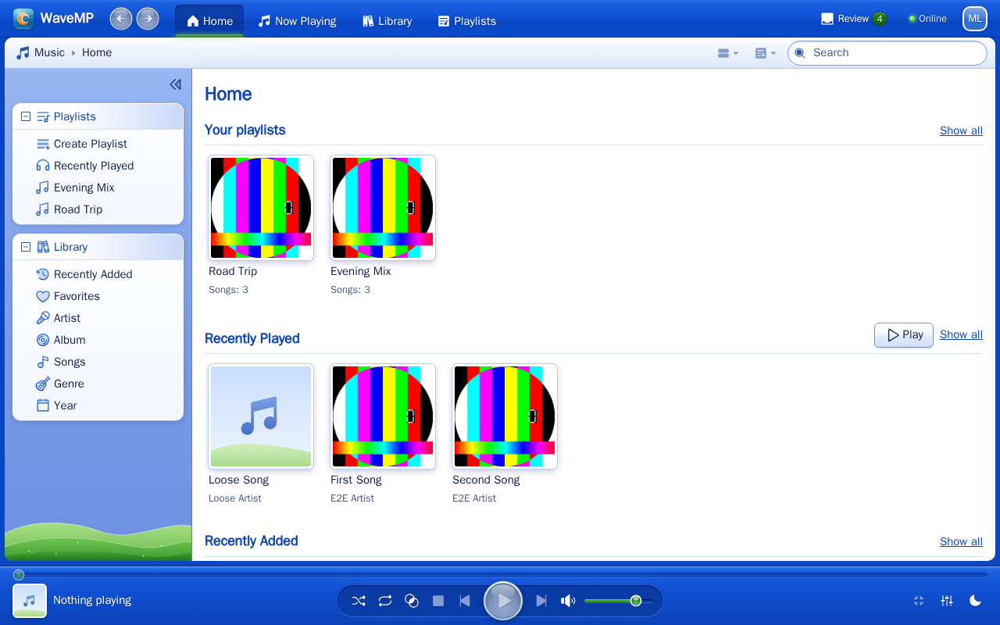

### Daylight

The light sister of Midnight: the same full-width bands for header, toolbar and transport, each with a bright sky gloss, a pale sidebar next to the white content, azure keys for the chosen options and an azure glass play button. A soft halo in the color of the cover sits behind the stage, and the full-screen player and the profile selection are open sky with clouds.

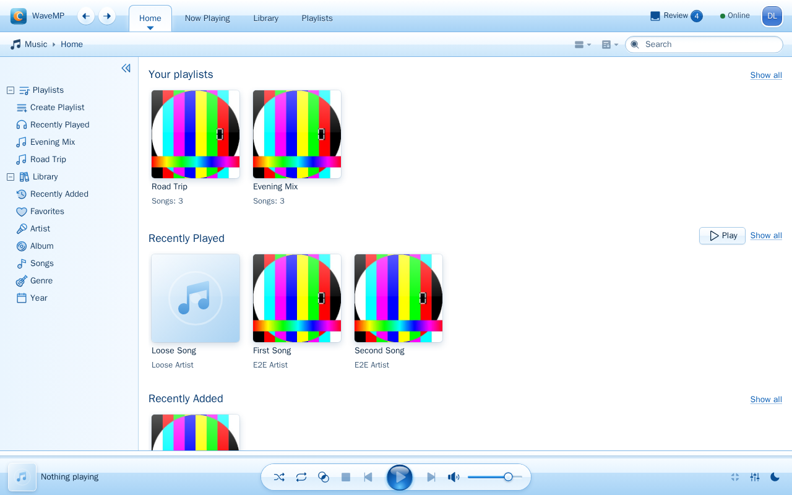

### Accent

A calm, flat theme in light and dark: frosted panes over a soft field of mist and warm glow with fine contour waves. Color means one thing only: a short ember line marks what is active, the song that is playing and the progress of the song. Everything else is ink and slate.

| Light | Dark |
|---|---|
| 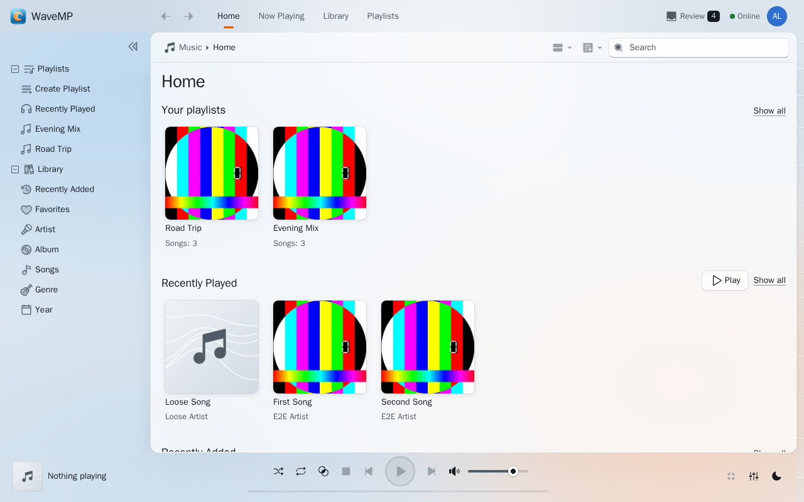 | 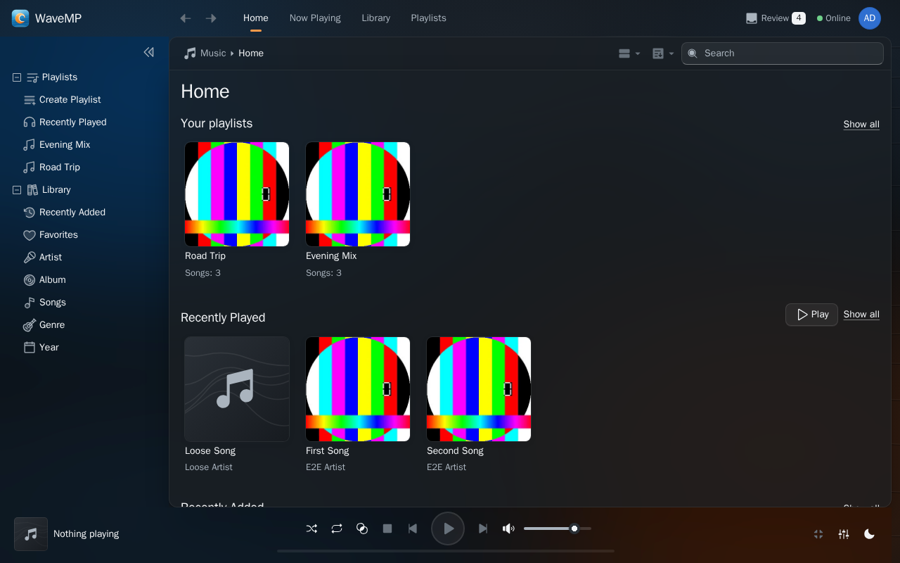 |

### Pinstripe

A light hi-fi theme on fine horizontal pinstripes. On the desktop the transport moves to the top and forms one brushed-metal plate with silver buttons, a teal play button and a backlit display in the middle that shows the cover, title, artist and progress of the song. Tabs and option groups are silver capsules, the sidebar is cool blue-gray with teal selection bars, lists are white tables with alternating rows, and empty covers are brushed aluminium.

| Home | Now Playing |
|---|---|
| 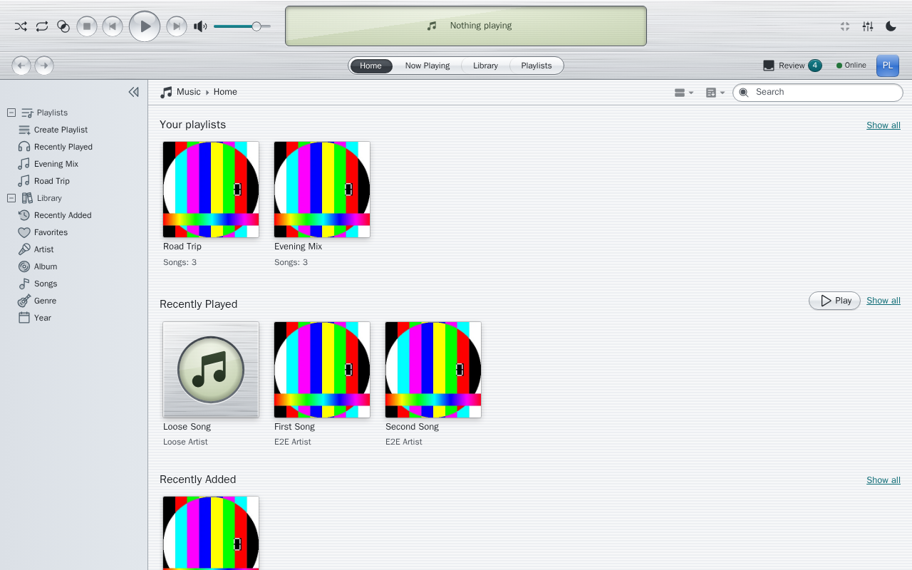 | 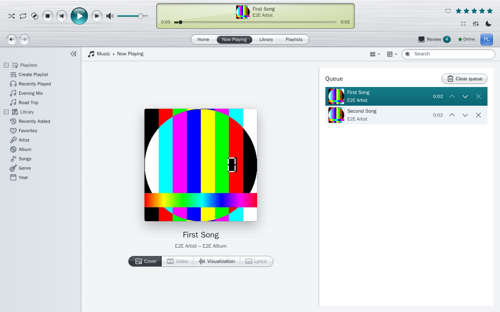 |

### Clear Glass

Clear, refracting glass in light and dark: header, sidebar, toolbar, content and the transport float as separate panes with large rounded corners over a field of light. The panes blur what lies behind them and catch the light at their edges. A pool of light and the play button take on the color of the current cover and fade from song to song, and a raised glass lens slides to the active tab, option or entry.

| Light | Dark |
|---|---|
| 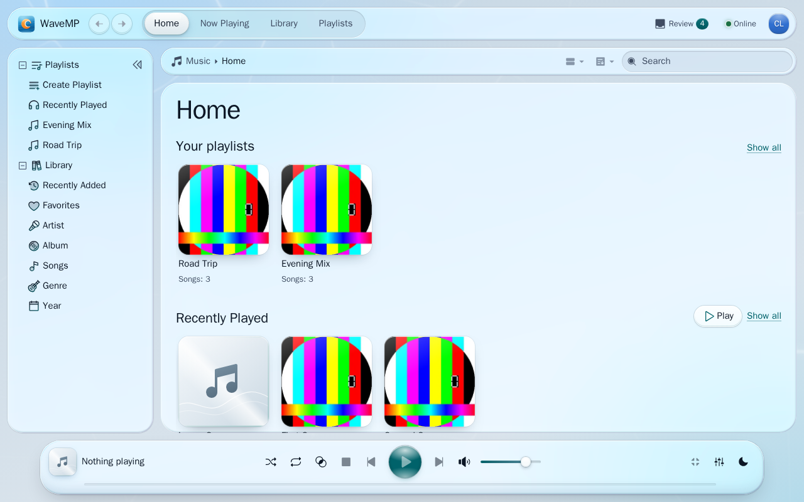 | 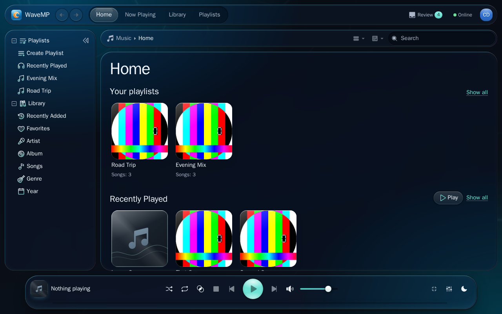 |

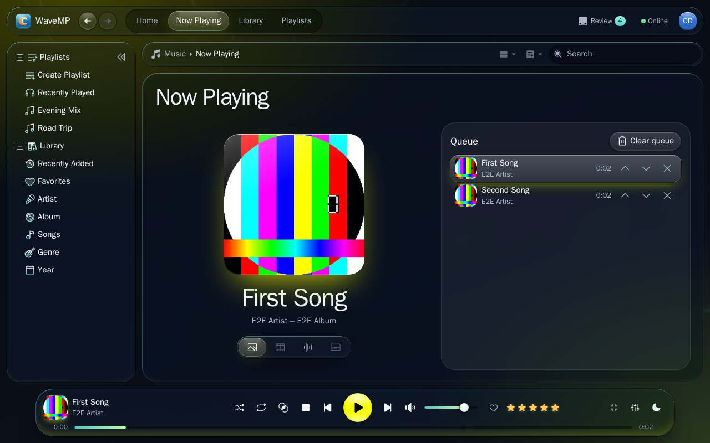

### Midnight

The default theme stays as it was, with clearer text: the glossy buttons and the review badge start darker, the icons in the content are darker gray, and the built-in admin profile in the profile selection is easier to read.

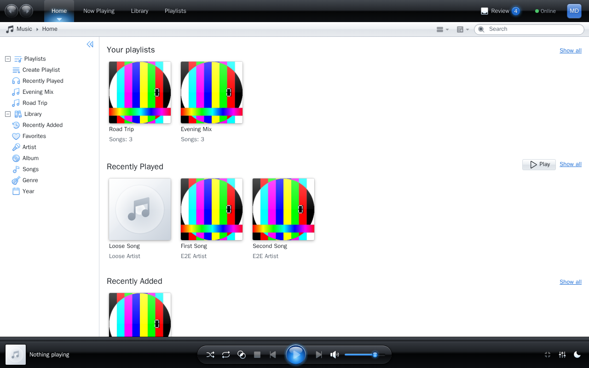

### On your phone

Every theme has its own look on smartphones as well, with its colors in the header, the player and the bottom navigation.

  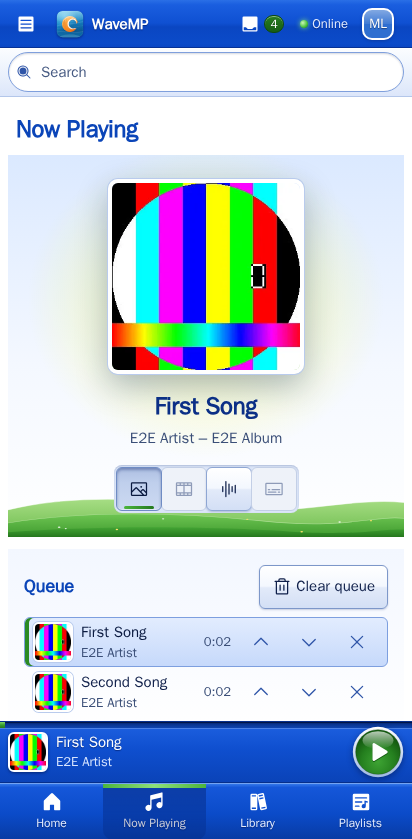
  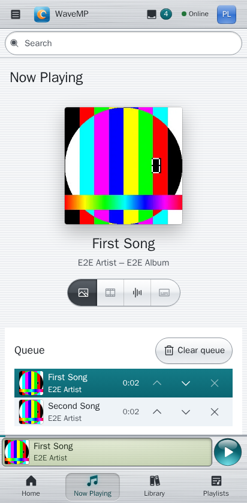
  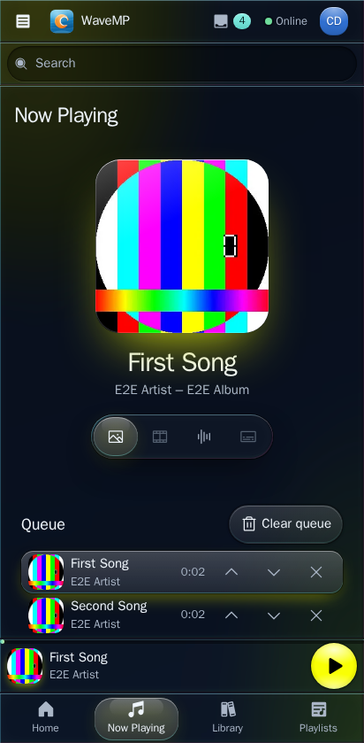
  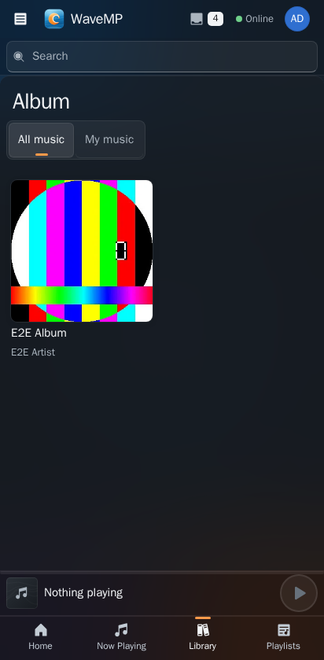

All six themes keep text and icons readable: every theme and variant meets the contrast of WCAG 2.2 AA.

## Choosing a theme

- **Your look, your profile.** Under **Settings > Appearance**, every profile picks its theme from tiles with a preview picture. WaveMP switches at once, without reloading, and keeps the choice with the profile on all its devices.
- **Light or dark.** For themes with both variants (Accent and Clear Glass), **Light or dark** chooses **System**, which follows the light or dark mode of your device, **Light** or **Dark**. Themes with one variant show it always.
- **The right look from the start.** WaveMP opens in the theme of the profile right away, without flashing the default theme first.
- **The color of the music.** Several themes pick up the main color of the cover that is playing, such as the glow behind the stage, and let it fade from song to song. The colors are chosen so that text stays readable on them.

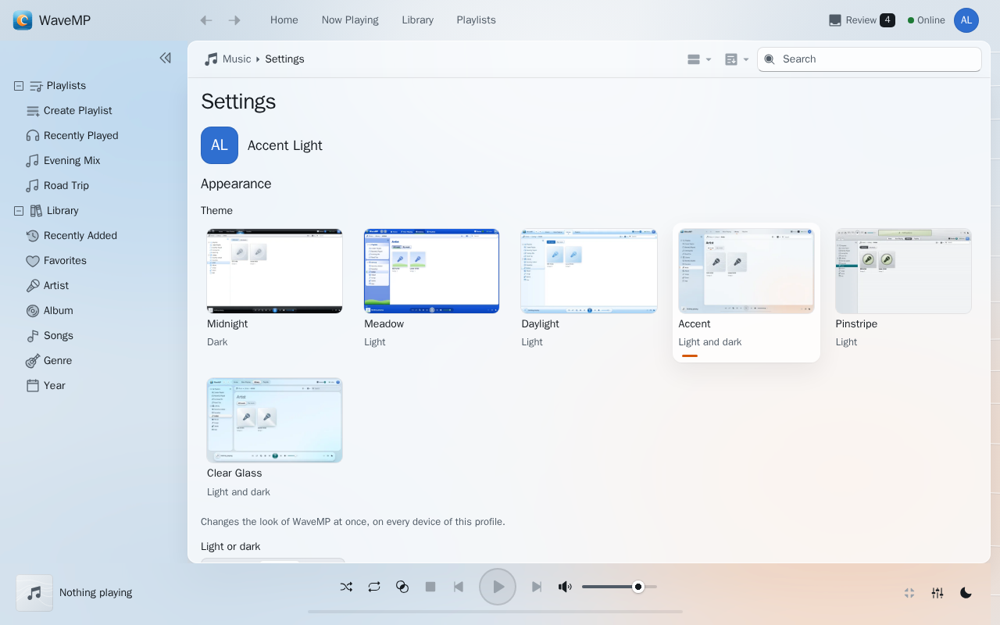

## Your own themes

- **Install themes as ZIP packages.** Admins upload own themes under **Administration > Themes**. A theme package holds a `manifest.json` with the name, author, version and variants of the theme, exactly one CSS file and SVG, PNG or WebP pictures, including a preview picture per variant.
- **Start from the template.** **Download the template** gives you a complete example theme with a commented CSS file, a manifest and pictures, ready to change, zip and upload. [THEMING.md](https://github.com/wavemp-app/wavemp/blob/v1.0.72/THEMING.md) is the guide for theme authors, with all parts, states, variables and the rules for packages.
- **For every profile.** Once installed, the theme appears in the theme picker of every profile, after the shipped themes.
- **New versions and deleting.** The theme page lists the installed themes with their previews, author and version. **Upload a new version** replaces a theme, and profiles that use it see the new version at once. A deleted theme is replaced by the default theme for the profiles that used it.
- **Clear feedback.** A package that breaks the rules is not installed; WaveMP lists every problem with the file and line where it is, in your language.
- **Safe by design.** A theme can only change the look: WaveMP checks every package completely before it installs it. Themes cannot run scripts or load anything from other servers, SVG pictures are cleaned, and sizes are limited. The largest package is 10 MB by default and can be changed with `Themes__MaxUploadBytes`; [THEMING.md](https://github.com/wavemp-app/wavemp/blob/v1.0.72/THEMING.md#uploaded-themes) lists the other limits.
- Uploaded themes are stored in the new folder `themes` in `/data`.

## Improvements

- **Settings keep up with you.** The settings no longer lock their fields while a change is saved. Moving through options with the arrow keys, clicking several options quickly or changing a menu and a checkbox one after the other no longer loses keys, clicks or the focus: every change shows at once and is saved in the order you made it.
- **Equalizer knobs in place.** The knobs of the equalizer now sit at the value of their band instead of near the bottom.
- **More readable details.** The artist and length in the queue, the artist in the transport bar and the scale of the equalizer are no longer dimmed below a readable contrast, and a switched-off equalizer only fades its sliders, not its labels.
- **Administration on tablets.** The tabs of the administration now wrap onto further rows when they do not fit, for example on a tablet in portrait, instead of scrolling sideways.
- **Stricter browser security.** The web app now tells the browser to load scripts, styles, pictures, fonts and media only from your WaveMP server, apart from what casting needs, as an extra protection against code from elsewhere. WaveMP can still be embedded in a dashboard.

## For developers

- **Theme of a profile.** `PATCH /api/v1/me/settings` takes the group `theme` with the id of the theme and the appearance (`System`, `Light`, `Dark`).
- **New API endpoints** for uploaded themes: `GET /api/v1/themes` and `GET /api/v1/themes/{id}` list them for every profile, admins install, replace and delete them with `POST`, `PUT` and `DELETE`, their files are served under `/api/v1/themes/{id}/files/...`, and `GET /api/v1/theme-template` downloads the template. Rejected packages return stable error codes, all described in the OpenAPI document.
- **Theme API.** THEMING.md now describes light and dark variants in one CSS file, the color of the current cover as CSS variables, a time display in the transport bar and the new parts of the settings and the theme page. The changes are additions only, so the theme API stays at version 5.
- **Tools for theme authors** working with the source code: a live preview of a theme on its own port (`npm run theme:preview -- <theme>` in `source/WaveMP.Web`), and screenshots of fixed views with a contrast check after WCAG 2.2 AA (`npm run theme:screenshots` and `npm run theme:contrast` in `tests/WaveMP.E2E`).

## Upgrade notes

- **Back up the new folder.** Uploaded themes live in `/data/themes`. If your backup leaves out single folders of `/data`, add this one.
- **Reverse proxies.** If your reverse proxy adds scripts to the pages of WaveMP or loads styles from other servers into them, the browser now blocks them.
- All profiles keep Midnight until they choose another theme.

## Known limitations

- Uploaded themes cannot bring their own fonts or JPEG pictures; they can use fonts that are installed on the device.
- Only Accent and Clear Glass have a light and a dark variant; the other themes show their one variant whatever the appearance of the profile.
- WaveMP is not listed in the app catalogs of NAS systems yet.
