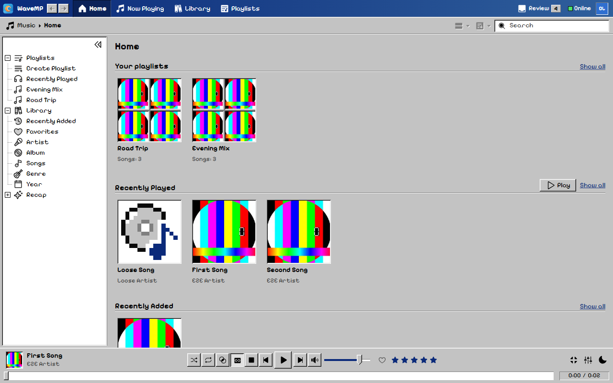
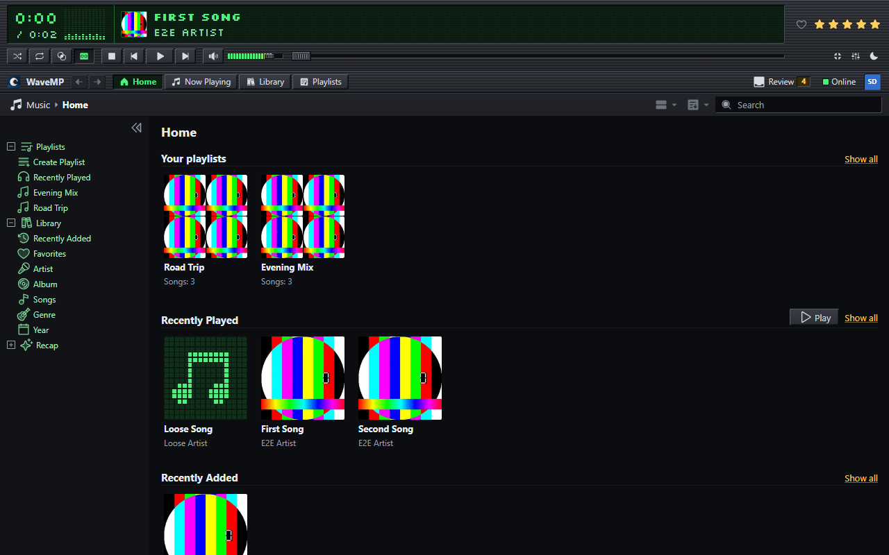

# WaveMP M8: Better UI

The eighth milestone of WaveMP is about how WaveMP feels in everyday use. Long lists zoom out to an overview of their groups, and admins gather songs into albums of their own and let WaveMP sort the files into tidy folders. All your open devices know each other now: control the music on one from another, or move it there. On an iPhone or iPad the music keeps playing in the background and on the locked screen. Artists get pictures, the visualizations react much more strongly to the music while Milkdrop calms down, and two new themes, Classic 9x and Skinned, join a reworked Daylight. Subtle animations, larger touch targets and a smoother player on phones round off the interface, and your favorites, ratings, plays and playlist entries now stay with your songs when you rename their files or folders.

## Upgrading

- **What an update keeps.** Updating from an earlier release, for example the release of M7, keeps your library and everything attached to it. The first scan after the update reads all audio files once more (to find the compilation flag, see [Fixes](#fixes)) and forms the albums of compilations again; the favorites of all profiles, the cover rule, an online cover and the date added of every album go with its songs to the album they belong to now.
- **If you ran WaveMP 1.0.128, 1.0.129 or 1.0.130.** These versions formed the albums of compilations again without carrying their favorites, cover rules and online covers over. This release cannot bring back what was lost there. If you want it back, restore an export of the database made before you updated to one of these versions (a daily export in `/data/backups` or your own copy, see [Backup & Restore](../../README.md#backup--restore)) and then start this version, which forms the albums again and keeps their data. Everything changed since that export, such as new plays, ratings and playlists, is lost by the restore; otherwise, mark the favorites and set the cover rules again.

## Library

### Quick jump to a group

Long lists are divided into groups, and their group headings are now buttons: the songs by album, the albums by album artist, initial letter or year (following the sort order), the artists by initial letter and the songs of an album with several discs by disc.

- **Zoom out.** Click or tap a group heading, pinch the list with two fingers, or press Ctrl+Minus or Escape, and the list zooms out to an overview of all its groups, albums with their cover. The current group is highlighted.
- **Jump.** Choose a group, and the list zooms back in and shows it at the top, without loading everything before it, even in a library of many thousand songs. Earlier entries load when you scroll up.
- **Letters.** Lists with many groups sorted by name or title also show a letter bar from A to Z and **#** for digits and other characters.
- **Keyboard.** In the overview the arrow keys, Home, End, Page Up and Page Down move between the groups, typing a name jumps to it, and Escape returns to the list unchanged.

With reduced motion switched on in your system, the overview appears without zooming. Pinching opens the overview only while the page is not zoomed in, and Ctrl+Minus and Escape keep their usual meaning wherever no grouped list is shown.

### Own albums and a tidy library

Admins can now gather songs into albums of their own and let WaveMP move the files into the folders and names they want, always with a preview first. Nothing is ever reorganized automatically.

- **Layout template.** **Administration > Library > File layout** sets where songs belong, for example `{AlbumArtist}/{Album}/{TrackNumber:00} {Title}` with a folder per album artist and album, or `{Artist} - {Title}` for all songs in one folder. Pick **Folders** or **Flat**, or write your own and insert placeholders with a click; a live preview shows where songs of your library would go. Characters that file systems do not allow are replaced.
- **Own albums.** **Administration > Organize** creates albums with a title, an album artist and, if you like, a year, a genre and a cover. Add songs with **Add songs** or **Add to own album** in the context menu of songs and albums, sort them by dragging or with Alt and the arrow keys. Moving the album writes album, album artist, track number, year and genre into the audio files (never into videos, with the previous tags kept) and moves all files of each song together.
- **Reorganize the library.** **Reorganize the library** works out in the background where every song of the library, or of one media folder, would go by the template, with its progress and **Stop**.
- **Preview first.** **Preview changes** lists every song with its old and new path, the files that move with it, the tags that will be written, warnings and conflicts. **Move files** carries out exactly this preview; songs with a conflict are moved only if you choose **Skip songs with conflicts**.
- **Your files are safe.** WaveMP never overwrites a file. Every step is recorded before it happens, so a restart in the middle of a move puts the interrupted song back. Empty folders are removed, the library follows at once without a full scan, and favorites, ratings, the play history, playlists and saved queues stay with the songs.
- **Undo.** The log on **Administration > Organize** lists every run; **Show changes** shows what it did and **Undo** moves the files back and restores the tags it wrote.
- **Cleaner titles.** A title tag such as `Artist - Song` is shown as `Song` when the part before ` - ` is the artist of the song. With a template that uses folders it must match the artist tag exactly; with a flat template, letter case, spaces and accents do not matter. Your files are not changed by this.

Organizing needs a media folder that WaveMP can write to. While it is mounted read-only, missing or switched off, the page says so and its buttons stay disabled.

### Artist pictures

Artists now show a picture on their page, in the list of artists, in the search results, the favorites and on the home page. WaveMP takes the first one of these that exists:

1. **A picture in the folder of the artist**, named `artist`, `folder` or `photo` (for example `artist.jpg`). The names are set under **Administration > Library > Names of artist pictures**.
2. **An uploaded picture.** Admins choose **Change picture** on the page of an artist and upload a JPEG, PNG or WebP picture of up to 10 MB, which they move and zoom until the square shows what they want.
3. **A picture from the internet.** Off by default: switch on **Find artist pictures online** under **Administration > Library**. While it is off, WaveMP sends no request for artist pictures anywhere. When it is on, **Online** in the picture dialog finds the artist on MusicBrainz and shows the pictures Wikimedia Commons and, with a personal **fanart.tv API key**, fanart.tv know of it, with their author and license. Nothing is taken over until you choose **Use this picture**; the author, license and source then appear below the picture on the page of the artist.
4. **A collage** of the covers of up to four of its albums. Only an artist without any album cover shows the artist symbol.

WaveMP downloads pictures from the internet itself, so the browsers of the viewers never contact these services, and keeps the answers in its cache for 7 days.

### Your data stays with your songs

Renaming files and folders, correcting a spelling or forming albums anew no longer loses what your profiles attached to a song, an album or an artist.

- **Renamed and moved songs.** When you rename the folder of a song, move it to another folder or media folder, or rename its files, the song keeps the favorites of all profiles, their ratings, the play history (and with it recently played, the statistics and the recaps), its entries in every playlist, its place in saved queues, the files chosen for it, its review state, the date it was added, its cover rule, video offset, online cover and downloaded lyrics. WaveMP recognizes a song by the file it plays, its audio file or, without one, its video: the new file must have the same type, extension, size and length and the same title, artist, album artist, album, track number, disc number and year in its tags, and it must be the only such file among the files that are gone and the new files of the scan. One scan has to see both the old and the new place; a full scan always does, and so does the scan after a rename that the folder watching noticed. In any doubt, for example for identical copies or files that were changed while they were moved, WaveMP adds the song as a new one as before; it never gives data to another song.
- **Albums.** When songs move to another album, through the metadata editor, tags changed outside WaveMP, a renamed folder or the forming of the albums after an update, the favorites of all profiles, the cover rule, an online cover and the date added of the album go with them as soon as the old album has no songs left. Joined albums keep the favorites of all of them; when an album is split, every album that got some of its songs gets its favorites and, unless it has its own, its cover rule.
- **Artists.** When the artist or album artist of songs is spelled differently, the favorites of all profiles and the date added of the old artist go to the new spelling as soon as the old one has no songs and albums left, and so do its uploaded and online pictures, unless the new artist has its own. Rules of smart playlists keep the artist name as you typed it, so adjust them after renaming an artist.

### Lyrics lookup

Admins can now ask LRCLIB again sooner for songs it had no lyrics for or listed as instrumental: **Forget results** in the section **Lyrics lookup** under **Administration > Library** does this for all songs, **Forget result** in the lyrics of a song for that song. The next run of the lyrics download looks them up again at once instead of waiting for `Lyrics__LookUpAgainAfter`. Lyrics already found are kept.

## Player

### Play on your other devices

Every browser, tab and installed app that opens WaveMP with your profile is now one of your devices, and they all know what the others play.

- **Play on.** The devices button in the transport bar (in the expanded player on phones) lists the open devices of your profile; the one that plays is checked.
- **Allow remote control.** A device can only be controlled from your other devices after you turned on **Allow remote control** in its device list. The permission lasts until that page is reloaded or closed and is never stored. Devices without it are greyed out on the others.
- **A remote in your hand.** While the device that plays allows remote control, your other devices show its song, position, volume, shuffle, repeat and queue live with **Playing on** and its name, and their controls act on it: play and pause, skip, seek, volume, shuffle, repeat, crossfade, autoplay, playing songs, albums and playlists, and changing the queue.
- **Move the music.** Choose a device in the list, and the song goes on there at the same position while the device before stops. **This device** brings the music back.
- **Name your devices.** **Settings > Devices** gives your devices names you recognize and forgets the ones you no longer use.

A device only sees and controls the devices of its own profile. Behind a reverse proxy, the devices work best with WebSockets passed on; the [README](../../README.md#reverse-proxy) shows the settings for nginx and Caddy.

### Music in the background on iPhone and iPad

On an iPhone or iPad the music now keeps playing while WaveMP is in the background or the screen is locked, from song to song. The lock screen shows the song with its cover, and play, pause, next, previous and the seek bar work there. In the background the equalizer, crossfade and visualization rest, because the system stops the audio processing of pages in the background; they come back as soon as you return to WaveMP, without a break in the music. A note on the equalizer and under **Settings > Playback** says so on these devices. If the music does not start from the lock screen after a long pause, open WaveMP: the song waits paused at the right position and plays on the first tap.

### Visualizations

- **Stronger reaction.** A-Force, BlackCap and Milkdrop react much more clearly to the music, also at a low volume: the bass, the mids and the highs each move the picture in their own way, beats land as visible punches, and quiet passages slow the picture down and dim it.
- **Calmer Milkdrop.** The Milkdrop presets move at the same speed on every display, whatever its refresh rate, and blend into each other more slowly. **Settings > Milkdrop speed** sets their speed from 25 % to 100 % of the original (50 % by default). Every preset now swells and lights up softly on the beat.
- **Modes and color schemes.** A-Force and BlackCap each have five modes, chosen like presets: **Flow**, **Rings**, **Warp**, **Ridges** and **Helix** for A-Force, **Drift**, **Orbit**, **Cluster**, **Ribbon** and **Bloom** for BlackCap. The new color scheme button sets their colors apart from the mode, with six color schemes each, and a chosen color scheme stays when the mode changes. A former A-Force style or BlackCap scene becomes the color scheme of the same name.
- **No flashing light.** All three visualizations guard against flashes: no larger area of the picture flashes more than three times a second, also while presets, modes or color schemes change quickly.
- **Gentler if you like.** **Settings > Visualization intensity** set to **Reduced** moves more gently, reacts less strongly and changes the brightness more slowly. It is always used while your device asks for reduced motion.
- **Controls below the picture.** The controls of the visualization no longer cover it, but lie in a bar right below it. The preset list opens as a menu above its button on computers, where typing the first letters of a name jumps to it, and as a sheet from the bottom edge on phones. The full screen shows the picture alone.

### The player on phones

- **Swipe down.** Swipe the expanded player down to make it small again; a short, fast flick is enough.
- **Switch the view.** Tap the cover or the title in the expanded player to switch between **Cover**, **Video** and **Visualization** right there.
- **Scrolling titles.** Titles and artists too long for their place scroll slowly after a few seconds, in the transport bar, the expanded player and the mini player. With reduced motion they end with "..." instead.

## Playlists

Playlists without their own picture now always show a 2x2 grid of the covers of their songs, from different albums. With more than four covers, the tiles change calmly one at a time, each new cover sliding in from the outer edge of its tile, and only while the playlist is on screen. With reduced motion switched on in your system, the new cover fades in instead.

## Look and feel

- **Subtle animations.** Buttons and tiles give way slightly when pressed, the marker of a button group slides to the chosen option, menus grow from where they were opened, dialogs fade in and pages and lists appear softly. With reduced motion switched on in your system, nothing moves; menus, dialogs and pages only fade briefly.
- **Videos at a glance.** In song lists, the video icon now sits in its own column left of the title, so all titles start at the same place.
- **The logo leads home.** The WaveMP logo in the header leads back to **Home** from every page, on the desktop and on phones.
- **Easier to tap.** On phones every button, link, field and entry is at least 44 pixels high, in every theme.
- **Type to jump in menus.** In every context menu, typing the first letters of an entry jumps to it.

## Subsonic apps

- **One music folder per media folder.** Subsonic apps now see each media folder that is switched on as a music folder with its name, so apps that offer a choice of music folders can show only the artists, albums, songs, search results and favorites of one of them. The first media folder keeps its earlier id, so apps set up before still find it.
- **Smart playlists.** Smart playlists now appear in the apps after the normal playlists, with the songs they hold at that moment. The apps cannot change their songs or rename them; deleting one in an app deletes the smart playlist.

## Themes

WaveMP now ships with eight themes.

### Classic 9x

A light theme in the look of a late-1990s desktop: gray bevelled surfaces, navy title bars, sunken white lists, tabs like a property sheet, square artist portraits and a pixel font, Pixelify Sans (SIL Open Font License 1.1). On phones the bottom navigation is a raised task bar.

### Skinned

A compact dark player: the transport sits on top with one green display for the time, a small cover and the scrolling title, small spectrum bars that move while the music plays, bevelled keys and compact lists, in the pixel font Silkscreen (SIL Open Font License 1.1).

| Classic 9x | Skinned |
|---|---|
|  |  |

### Daylight

Daylight is now a light glass music library on the desktop: a breadcrumb bar with round back and forward buttons in the header, a slim toolbar, the songs grouped by album with a large cover and its details, the play queue docked on the right with the tabs **Queue** and **Lyrics**, and a large round play button in the middle of the transport bar. **View options** in the toolbar switches the lists of songs between **Grouped by album** and a plain **List**. Daylight now brings its own font, Selawik (SIL Open Font License 1.1). On phones it keeps the usual mobile layout in its colors.

### Uploaded themes

Uploaded themes that break a security rule of this version, an unsafe construct in their CSS or SVG files, are now marked **Blocked** under **Administration > Themes** and no longer delivered; profiles that chose one see Midnight until a fixed version is uploaded, and get their choice back then. Themes that only break other rules stay **Outdated** and usable as before.

### Theme API

The theme API goes from version 5 to version 8: version 6 makes playlist covers a grid of tiles, version 7 moves the controls of the visualization below the picture, and version 8 turns group headings into buttons and groups the tiles of albums and artists. It also gains parts for the quick jump, own albums and organizing, devices and remote control, artist pictures, the lyrics lookup, the full-screen player on phones and the docked queue, variables for animations and touch targets, and layout options with which a theme can move the breadcrumb into the header, dock the queue and offer the view options. All shipped themes are styled for the new parts. Uploaded themes written for version 5 to 7 are still accepted; [THEMING.md](../../THEMING.md) describes what changed in each version.

## Fixes

- **Compilations stay together.** Songs that carry the compilation flag in their tags but no album artist tag now form one album per album name and folder, instead of one album for each artist.
- **Compilations are marked again.** An album counts as a compilation again when at least one of its songs carries the compilation flag or its album artist is `Various Artists`, and albums without an artist then show "Various artists" instead of "Unknown artist".
- **Continue listening.** If the song saved by another device cannot be loaded when WaveMP starts, for example because you reloaded the page right away, the player now waits at it and the saved state of the other device stays as it is; **Play** tries again. Before, the player skipped to the next song and replaced the saved state.
- **Settings chosen right after the start.** A theme, language or other setting chosen while WaveMP is still loading no longer jumps back to the earlier value.
- **Administration settings.** The settings of backups, transcoding and the online search for album info save only the values you changed, so they no longer reset values another admin changed in the meantime. The settings of the cache, transcoding and the library can be changed only once they are loaded.
- **Cover options on phones.** The options of the cover rule on the page of a song or album, and other option groups in forms, no longer run past the edge of the screen on phones; their labels wrap instead.
- **Menus of playlist entries.** The menu of a playlist entry that was opened while another change was being saved now offers **Move up**, **Move down** and **Remove from playlist** as soon as the change is done.
- **Accent.** In the light variant, the play time stays readable under the shadow of an open menu.
- **Fast flicks on busy phones.** A short, fast flick down closes the expanded player also on a phone that is busy, instead of letting it snap back.

## For developers

- **Groups of lists.** `GET /api/v1/tracks/groups`, `GET /api/v1/albums/groups` and `GET /api/v1/artists/groups` return the groups of a list (kind, position, count and the album, artist, letter or year) with the same filters and sort order as the list.
- **Own albums and organizing.** `/api/v1/own-albums` lists, creates, changes and deletes own albums with their songs and cover. `/api/v1/organize` checks the media folders (`availability`), previews templates (`template-preview`), creates previews (`preview`), applies them (`apply`), undoes runs (`undo/{id}`) and lists the log (`operations`, with their items and `cancel`). `GET` and `PATCH /api/v1/settings/organizing` read and change the layout template. The reorganization runs as the job `library-organize`.
- **Devices.** `GET /api/v1/me/devices` lists the devices of a profile, `PATCH` and `DELETE /api/v1/me/devices/{deviceId}` rename and forget one, and `POST /api/v1/me/device-hub-tickets` hands out a short-lived ticket for the real-time connection. The connection is a SignalR hub at `/api/v1/hubs/devices`; its messages are described in [asyncapi.yaml](../../asyncapi.yaml), next to the OpenAPI document.
- **Artist pictures.** Every artist names its `picture`. `GET /api/v1/artists/{id}/picture` delivers it; `.../uploaded-picture` uploads and removes a picture; `.../musicbrainz-matches`, `.../online-picture-candidates` (with a `preview` of each) and `.../online-picture` find, preview and take over a picture from the internet. `GET` and `PATCH /api/v1/settings/artist-pictures` configure the names of artist pictures, the online lookup and the fanart.tv key, which is never returned.
- **Lyrics lookup.** `GET /api/v1/lyrics-lookups/summary` and `DELETE /api/v1/lyrics-lookups` count and forget the results without lyrics; `GET` and `DELETE /api/v1/tracks/{id}/lyrics/lookup` do the same for one song.
- **Visualizations.** `PATCH /api/v1/me/settings` takes `colorScheme`, `intensity` (`Normal` or `Reduced`) and `milkdropSpeed` (10 to 100) in the group `visualization`.
- **Albums.** `isCompilation` is set from the tags again.
- **Playlists.** The cover `Tracks` of a playlist names up to twelve tracks of different albums.
- **Themes.** `status` of a theme can now be `Blocked`.
- **Subsonic.** `getMusicFolders` lists one music folder per media folder that is switched on, and `musicFolderId` narrows `getIndexes`, `getArtists`, `getAlbumList2`, `getRandomSongs`, `search3` and `getStarred2`. `getPlaylists` lists the smart playlists with ids starting with `sp-` and `readonly` set to true; `getPlaylist` and `getCoverArt` understand these ids, `updatePlaylist` refuses them and `deletePlaylist` deletes the smart playlist.
- **New error codes:** `artist.picture_not_found`, `artist.picture_too_large`, `artist.picture_unsupported_format`, `artist.picture_unreadable`, `artist.picture_lookup_disabled`, `artist.picture_lookup_unavailable`, `artist.picture_candidate_not_found`, `lyrics.lookup_not_found`, `lyrics.lookup_found_lyrics`, `device.not_found`, `device.online` and the codes of organizing, which start with `organize.`.
- **New settings:** `ArtistPictures__MaxUploadBytes`, `ArtistPictures__MaxDownloadBytes`, `ArtistPictures__MaxJsonBytes`, `ArtistPictures__LookupCacheDuration`, `ArtistPictures__RequestTimeout`, `Organizing__PreviewLifetime`, `Organizing__PreviewRetention` and `Organizing__MaxCoverBytes`; the [README](../../README.md#settings) describes them.

All new endpoints and codes are described in the OpenAPI document.

## Upgrade notes

- **The first scan takes longer.** It reads all audio files once more to find the compilation flag and forms the albums of compilations again, see [Upgrading](#upgrading).
- **Milkdrop is slower.** The Milkdrop presets now move at 50 % of their original speed by default. Set **Settings > Milkdrop speed** to 100 % for the earlier pace.
- **Uploaded themes.** Themes written for an earlier theme API version still load, but may look wrong in playlist covers, the controls of the visualization and the group headings and tiles of the library; check them and upload a new version. A theme that breaks a security rule is blocked, see [Uploaded themes](#uploaded-themes).
- **Reverse proxy.** The devices of a profile keep a real-time connection to `/api/v1/hubs/devices`. It works behind every proxy, but is quickest with WebSockets passed on; for nginx, also turn off buffering for this path, see [Reverse proxy](../../README.md#reverse-proxy).
- **Back up the new folders.** Uploaded and online artist pictures live in `/data/artist-pictures`, and the covers of own albums in `/data/own-album-covers`. If your backup leaves out single folders of `/data`, add these.
- **Remote control is off.** Every device starts without remote control; turn on **Allow remote control** on each device you want to control, after every reload.

## Known limitations

- An iPhone or iPad can only be seen and controlled from your other devices while WaveMP is open in the foreground there, because the system closes its connection in the background; when you return, it catches up at once.
- In the background on an iPhone or iPad, the volume slider and volume leveling may have no effect, because the system ignores the volume of a page there.
- The live state of the devices is kept in the memory of the server. Run one WaveMP container per database; several instances do not see each other's devices.
- A renamed or moved song keeps its data only if one scan sees both its old and its new place. A move whose two halves end up in separate scans, for example when the files are copied first and the old folder is deleted after the next scan, adds the song as a new one.
- Album and artist data lost by an earlier version cannot be restored by this release.
- Classic 9x comes in a light variant only and Skinned in a dark variant only. The new layout of Daylight needs a window at least 1024 pixels wide.
- The search results, the favorites, the playlists and the list of genres have no quick jump.
- Only admins can change artist pictures, and Subsonic apps do not show them.
